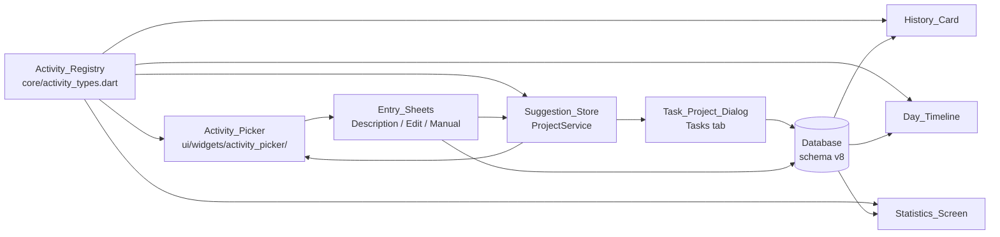
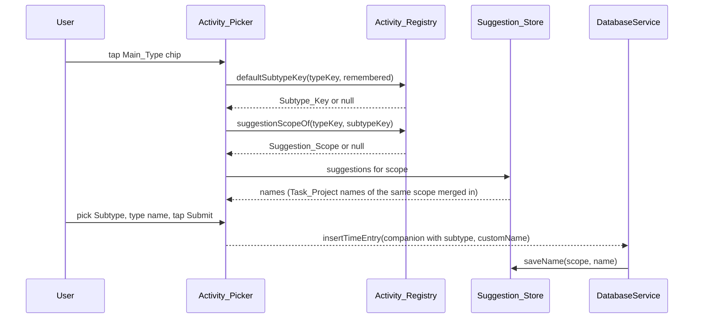

# Design Document: Activity Subtypes

## Overview

The App already has one special case of a sub-classification: `Zábava` carries an `entertainment_type` that is handled by name in three Entry_Sheets, the statistics provider and the History_Card. This design replaces that special case with a general model. A new `Activity_Registry` describes twelve Main_Types, each with an ordered list of Subtypes, a Main_Color, Subtype colours for Dark_Themes and the Light_Theme, and the kind of extra field it shows. Everything that draws or classifies an entry reads that one structure.

**Key design decisions:**

- **One registry replaces three parallel lists.** Today `activityTypes`, the `activityTypeColor()` switch and `activityTypeLabel()` must be edited together (see `timelog_app/CLAUDE.md`). The registry removes that coupling; the old helpers become thin readers of it.
- **One generic `subtype` column.** Paid / unpaid, active / passive, walk / running / gym and the rest all use the same column and the same picker, so there is no per-type special case left. The legacy `entertainment_type` column stays in the table, read only by the Migration and never written again, because dropping a column would need a table rebuild with no benefit.
- **Colours are computed, never stored.** The new palette therefore applies to every existing entry at once, and changing a colour later never needs a migration.
- **A subtype is always preselected.** The Activity_Picker preselects the last used Subtype of the Main_Type, otherwise the first one, so saving is never blocked and the user is never asked a question twice. The Subtype_Block is nevertheless visually separate so it is not overlooked.
- **`Ostatní` has its own `custom_name` column.** It is not stored in the project column, so Custom_Names never reach project suggestions, project statistics or task projects.
- **Suggestions are scoped by category and shared with the Tasks tab.** The Suggestion_Store keeps four lists (`workPaid`, `workUnpaid`, `housework`, `other`). The scope of an entry is derived from the registry. A Task_Project carries a scope of its own, chosen when it is created, and the names of Task_Projects are merged into the list of their scope. The Timer tab and the Tasks tab therefore use the same four lists, the same provider and the same `SuggestionField` widget.
- **One shared picker.** `DescriptionSheet`, `EditSheet` and `ManualEntrySheet` each contain a copy of the chip and project-field code today. The new `Activity_Picker` replaces all three copies, so the new behaviour is written once.



## Architecture

### Entry flow



### Statistics aggregation

`_computeStats` walks the entries of the period once. For each entry it adds the duration to the Main_Type total, to the Subtype total when the entry has a Subtype, to the project total when the Main_Type has a Project_Field, and to the name total when the entry is of `Ostatní`. Time of a Main_Type with Subtypes that has no Subtype is the difference between the Main_Type total and the sum of its Subtype totals, drawn in the Main_Color.

### Migration

The Migration is a single `from < 8` step. It adds two columns to `time_entries` and runs three `UPDATE` statements. It also adds the `scope` column to `task_projects`, but only when the Database is already at version 7, because the version 7 step (`from < 7`) creates the task tables from the current table definition, which already contains `scope`; adding it again would fail with a duplicate column. The Migration touches no other table. A Database that is much older than the current version (the installed iOS build may still be at schema version 5 or 6) therefore runs every earlier step first and then this one.

## Project Structure

```
timelog_app/
├── lib/
│   ├── core/
│   │   └── activity_types.dart        # MODIFIED: Activity_Registry, colour/scope/label helpers
│   ├── data/
│   │   ├── time_entry.dart            # MODIFIED: + subtype, + customName; entertainmentType kept (legacy)
│   │   ├── task_project.dart          # MODIFIED: + scope column
│   │   ├── database.dart              # MODIFIED: schemaVersion 8, from < 8 step
│   │   └── stats_data.dart            # MODIFIED: bySubtype, byCustomName replace byEntertainmentType
│   ├── services/
│   │   ├── project_service.dart       # MODIFIED: one list per Suggestion_Scope, seeding
│   │   ├── database_service.dart      # MODIFIED: updateDescription takes subtype, customName
│   │   ├── task_service.dart          # MODIFIED: createProject(scope), getProjectNames(scope)
│   │   └── timer_service.dart         # MODIFIED: prefill subtype / customName (+ freezed regen)
│   ├── providers/
│   │   ├── task_providers.dart        # MODIFIED: suggestionsProvider family replaces autocompleteProjectsProvider
│   │   └── statistics_provider.dart   # MODIFIED: subtype and custom-name aggregation
│   ├── l10n/                          # MODIFIED: app_en.arb, app_cs.arb, regenerated classes
│   └── ui/
│       ├── painters/
│       │   └── timeline_painter.dart  # MODIFIED: Entry_Color from the registry
│       ├── screens/
│       │   └── statistics_screen.dart # MODIFIED: stacked bars, subtype rows, "Other by name"
│       └── widgets/
│           ├── activity_picker/       # NEW: shared picker (replaces three copies of the chip code)
│           │   ├── activity_picker.dart   # type chips, Subtype_Block, extra field, remembered selection
│           │   ├── subtype_block.dart     # framed block with heading, hint and Subtype chips
│           │   └── suggestion_field.dart  # autocomplete text field for project and Custom_Name
│           ├── project_selector.dart  # MODIFIED: category chips and SuggestionField in the create dialog, scope dot on chips
│           ├── description_sheet.dart # MODIFIED: uses Activity_Picker
│           ├── edit_sheet.dart        # MODIFIED: uses Activity_Picker
│           ├── manual_entry_sheet.dart# MODIFIED: uses Activity_Picker
│           └── history_entry_card.dart# MODIFIED: badge colour, meta line
├── .design/
│   ├── activity-palette.html          # NEW: approved preview of types, subtypes and colours on the three themes
│   └── activity-types-ux.html         # NEW: approved preview of the entry sheet, history, statistics and Tasks tab
└── test/
    ├── core/activity_types_test.dart               # registry integrity, colours, scope
    ├── data/migration_v8_test.dart                 # v7 -> v8 data migration
    ├── services/project_service_scoped_test.dart   # scoped suggestions, expiry, seeding
    ├── providers/statistics_subtypes_test.dart     # aggregation partition
    └── ui/activity_picker_test.dart                # widget tests of the picker, the sheets and the Tasks tab dialog
```

`lib/ui/widgets/` already holds 20 source files, which is over the flat-directory ceiling in `infra-project-structure.md`. This project has no `scripts/check-structure.sh` yet. The new widgets go into a new subdirectory so the count does not grow; moving the existing widgets is out of scope. The new tests go into subdirectories that mirror `lib/`, so the already large flat `test/` directory does not grow.

## Components and Interfaces

### 1. Activity_Registry (`lib/core/activity_types.dart`)

The registry is a `const` list. Labels are resolved through `AppLocalizations` by `switch` on the keys, as the current `activityTypeLabel()` does, so keys are never translated.

```dart
enum TypeExtra { none, project, customName }

enum SuggestionScope { workPaid, workUnpaid, housework, other }

class ActivitySubtype {
  const ActivitySubtype({required this.key, required this.dark, required this.light});
  final String key;   // Subtype_Key, unique within its Main_Type
  final Color dark;   // Dark_Themes
  final Color light;  // Light_Theme
}

class ActivityType {
  const ActivityType({
    required this.key,
    required this.dark,
    required this.light,
    this.subtypes = const [],
    this.extra = TypeExtra.none,
  });
  final String key;                    // Type_Key
  final Color dark;                    // Main_Color, Dark_Themes
  final Color light;                   // Main_Color, Light_Theme
  final List<ActivitySubtype> subtypes;
  final TypeExtra extra;
}

const List<ActivityType> activityRegistry = [ /* twelve entries, see Data Models */ ];

ActivityType? activityTypeOf(String typeKey);
ActivitySubtype? subtypeOf(String typeKey, String? subtypeKey);

/// Subtype colour when the Subtype is valid for the type, else the Main_Color,
/// else neutral grey for an unknown type.
Color activityEntryColor(String typeKey, String? subtypeKey, {required bool isDark});
Color activityMainColor(String typeKey, {required bool isDark});

/// remembered when valid for the type, else the first Subtype, else null.
String? defaultSubtypeKey(String typeKey, {String? remembered});

/// null for types without suggestions.
SuggestionScope? suggestionScopeOf(String typeKey, String? subtypeKey);

/// Colour of a category: paid = `Práce` paid, unpaid = `Práce` unpaid, housework = `Domácí práce`, other = `Ostatní`.
Color suggestionScopeColor(SuggestionScope scope, {required bool isDark});
String suggestionScopeLabel(AppLocalizations l10n, SuggestionScope scope);

bool hasProjectField(String typeKey);
bool hasCustomNameField(String typeKey);

String activityTypeLabel(AppLocalizations l10n, String typeKey);
String subtypeLabel(AppLocalizations l10n, String typeKey, String subtypeKey);

/// Text and dot colour of the line below a History_Card description; null when there is nothing to show.
({String text, Color? dotColor})? entryMetaLine(
  AppLocalizations l10n, {
  required String typeKey,
  String? subtypeKey,
  String? project,
  String? customName,
  required bool isDark,
});
```

`activityTypes` stays as a derived `List<String>` of Type_Keys for code that only needs the keys. `workActivityTypes`, `isWorkActivityType`, `isHouseworkActivityType`, `entertainmentTypes`, `isEntertainmentActivityType` and `entertainmentTypeLabel` are removed; their callers read the registry.

### 2. Time_Entry table and Migration (`lib/data/time_entry.dart`, `lib/data/database.dart`)

```dart
// TimeEntries additions
TextColumn get subtype => text().nullable()();
TextColumn get customName => text().withLength(min: 0, max: 200).nullable()();
// entertainmentType stays declared; legacy, read only by the Migration, never written.

// AppDatabase
int get schemaVersion => 8;
// onUpgrade: if (from < 8) { addColumn(subtype); addColumn(customName); three UPDATE statements }
```

### 3. DatabaseService (`lib/services/database_service.dart`)

`insertTimeEntry(TimeEntriesCompanion)` keeps its signature; the Entry_Sheets set `subtype` and `customName` in the companion they pass. Only the update method changes:

```dart
Future<void> updateDescription(
  int id,
  String description, {
  String? activityType,
  Value<String?> project = const Value.absent(),
  Value<String?> subtype = const Value.absent(),     // replaces entertainmentType
  Value<String?> customName = const Value.absent(),  // new
  DateTime? startTime,
  DateTime? endTime,
});
```

The `entertainmentType` parameter is removed; nothing writes the legacy column any more.

### 4. Suggestion_Store (`lib/services/project_service.dart`, `lib/providers/task_providers.dart`)

```dart
class ProjectService {
  /// Names of one scope, newest first; expired names (30 days) are removed on read.
  Future<List<String>> getKnownNames(SuggestionScope scope);

  /// Adds or refreshes [name] in the list of [scope] only; case-insensitive de-duplication.
  Future<void> saveName(SuggestionScope scope, String name);

  /// One-time fill of the scoped lists from entries; removes the legacy combined list. Idempotent.
  Future<void> seedFromEntries(List<TimeEntry> entries);
}

final suggestionsProvider =
    FutureProvider.family<List<String>, SuggestionScope>((ref, scope) async { /* seed once, merge Task_Project names of the same scope in front */ });
```

Stored under the preference key `known_names_v3_<scope name>` as a JSON list of `{name, lastUsed}`; the seeding flag is `known_names_v3_seeded`. The legacy keys `known_projects` and `known_projects_v2` are removed after seeding. `autocompleteProjectsProvider` is removed. The Timer tab (through the Activity_Picker) and the Tasks tab (through the Task_Project_Dialog) both read `suggestionsProvider(scope)`.

### 5. Activity_Picker (`lib/ui/widgets/activity_picker/`)

```dart
@immutable
class ActivitySelection {
  const ActivitySelection({required this.typeKey, this.subtypeKey, this.project = '', this.customName = ''});
  final String typeKey;
  final String? subtypeKey;
  final String project;
  final String customName;
  ActivitySelection copyWith({String? typeKey, String? subtypeKey, String? project, String? customName});
  /// Normalised row values: project only for TypeExtra.project, customName only for TypeExtra.customName, subtype only when valid.
  ({String? subtype, String? project, String? customName}) toRowValues();
}

class ActivityPicker extends ConsumerStatefulWidget {
  const ActivityPicker({
    super.key,
    required this.theme,
    required this.initial,                 // from prefill, edit or empty
    required this.onChanged,               // ValueChanged<ActivitySelection>
    this.autofocusExtraField = false,
  });
  final AppThemeData theme;
  final ActivitySelection? initial;
  final ValueChanged<ActivitySelection> onChanged;
  final bool autofocusExtraField;
}

class SubtypeBlock extends StatelessWidget {
  const SubtypeBlock({super.key, required this.theme, required this.type,
      required this.selectedKey, required this.onSelected});
  final AppThemeData theme;
  final ActivityType type;
  final String? selectedKey;
  final ValueChanged<String> onSelected;
}

class SuggestionField extends ConsumerWidget {
  const SuggestionField({super.key, required this.theme, required this.scope,
      required this.hint, required this.initialText, required this.onChanged});
  final AppThemeData theme;
  final SuggestionScope scope;
  final String hint;
  final String initialText;
  final ValueChanged<String> onChanged;
}
```

Remembered selections use preferences: `last_activity_type` (existing key) for the Main_Type and `last_subtype_<typeKey>` for the Subtype. Layout constants: caption "Type" above the chips; `SubtypeBlock` top margin 26 logical pixels; frame border `Main_Color` at 55 percent alpha, fill `Main_Color` at 9 percent alpha, radius 14, inner padding 12 by 14; heading text `Main_Color`, 13 px, weight 600; hint 11 px in the theme `dim` colour; Subtype chips 12 px text, radius 16, selected state uses the Subtype colour at 20 percent alpha for the fill and 100 percent for border and text. The `Ostatní` chip uses a dashed border painted by a small `CustomPainter`.

### 6. Entry_Sheets (`lib/ui/widgets/description_sheet.dart`, `edit_sheet.dart`, `manual_entry_sheet.dart`)

Each sheet keeps one `ActivitySelection` in its state instead of `_selectedType`, `_entertainmentType` and a project controller. The submit predicate becomes:

```dart
bool get _canSubmit =>
    _description.trim().isNotEmpty &&
    !_saving &&
    !(hasCustomNameField(_selection.typeKey) && _selection.customName.trim().isEmpty);
```

`DescriptionSheet` replaces the preferences keys `last_entertainment_type` and `last_submitted_entertainment_type` with `last_submitted_subtype` and `last_submitted_custom_name`. A stored value that is not valid in the registry is ignored.

### 7. Timer_Service prefill (`lib/services/timer_service.dart`)

```dart
// TimerState: prefillEntertainmentType replaced by
String? prefillSubtype;
String? prefillCustomName;

void savePrefill(String description, String activityType,
    {String? project, String? subtype, String? customName});
```

Preference keys `timer_prefillSubtype` and `timer_prefillCustomName` replace `timer_prefillEntertainmentType`. On load, a value under the legacy key is mapped (`Aktivní zábava` to `active`, `Pasivní zábava` to `passive`, only when the persisted type is `Zábava`) and the legacy key is removed. `timer_service.freezed.dart` is regenerated.

### 8. History_Card (`lib/ui/widgets/history_entry_card.dart`)

The badge text is `activityTypeLabel`; its colour is `activityEntryColor`. The line below the description comes from `entryMetaLine`; the old project and entertainment lines are removed. The `entertainmentTypeLabel` call is deleted.

### 9. Day_Timeline (`lib/ui/painters/timeline_painter.dart`)

The block paint call becomes `activityEntryColor(entry.activityType, entry.subtype, isDark: isDark)`.

### 10. Statistics (`lib/data/stats_data.dart`, `lib/providers/statistics_provider.dart`, `lib/ui/screens/statistics_screen.dart`)

```dart
class NameStat {
  const NameStat({required this.name, required this.duration});
  final String name;
  final Duration duration;
}

class StatsData {
  // existing: totalTracked, untrackedTime, byActivityType, byProject, entries
  final Map<String, Map<String, Duration>> bySubtype; // typeKey -> subtypeKey -> duration; replaces byEntertainmentType
  final List<NameStat> byCustomName;                  // sorted by duration, longest first
}
```

`byProject` keeps including `Práce` and `Domácí práce` and is summed per project name and type as today. `_computeStats` uses `hasProjectField` instead of the removed work-type list. The dot of a project row uses `activityMainColor` of the project's Main_Type. The screen draws each Main_Type row as a header (label, time, share), a stacked bar scaled to the longest Main_Type, and the Subtype rows below it; the "Other by name" section follows "By project" and appears only when `byCustomName` is not empty.

### 11. Task projects and the Tasks tab (`lib/data/task_project.dart`, `lib/services/task_service.dart`, `lib/ui/widgets/project_selector.dart`)

```dart
// TaskProjects addition
TextColumn get scope => text().withDefault(const Constant('workUnpaid'))(); // SuggestionScope name

// TaskService
Future<int> createProject(String name, {SuggestionScope scope = SuggestionScope.workUnpaid});
Future<List<String>> getProjectNames(SuggestionScope scope);   // replaces the unscoped getProjectNames()
Future<void> updateProjectScope(int projectId, SuggestionScope scope);   // changes the category only

// project_selector.dart
// _CreateProjectDialog: caption taskProjectCategoryCaption, one chip per SuggestionScope (suggestionScopeLabel),
// SuggestionField(scope: selected) for the name, returns ({String name, SuggestionScope scope}).
// _CreateProjectDialog also has an edit mode: title taskProjectEditCategory, the name as plain text,
// the four category chips with the current scope selected, returns the new SuggestionScope.
// _ProjectChip: dot in suggestionScopeColor(project.scope) before the label; Semantics label
// taskProjectChipSemantics(name, category); long press opens a bottom sheet with two actions
// (taskProjectEditCategory, commonDelete); the existing delete button on the chip is unchanged.
```

The dialog remembers the last selected category in the preference `last_task_project_scope`. Long-pressing a chip currently deletes the project (after a confirmation); that gesture now opens a small bottom sheet with "Edit category" and "Delete", and the delete confirmation itself is unchanged. Only the category can be edited; renaming is not offered, because time entries keep the project name as plain text and a rename would silently disconnect them. The default `scope = workUnpaid` keeps the existing callers and tests of `createProject` valid.

### 12. Localization (`lib/l10n/app_en.arb`, `app_cs.arb`)

New keys, English then Czech:

| Key | English | Czech |
|---|---|---|
| `activityMeeting` | Meeting | Meeting |
| `activityCommunication` | Communication | Komunikace |
| `activityOther` | Other | Ostatní |
| `activityCommute` (value changed) | Travel | Cestování |
| `subtypePaid` | Paid | Placená |
| `subtypeUnpaid` | Unpaid | Neplacená |
| `subtypeEntertainmentActive` (renamed from `entertainmentActive`) | Active entertainment | Aktivní zábava |
| `subtypeEntertainmentPassive` (renamed from `entertainmentPassive`) | Passive entertainment | Pasivní zábava |
| `subtypeWalk` | Walk | Procházka |
| `subtypeRunning` | Running | Běhání |
| `subtypeGym` | Gym | Posilovna |
| `subtypeBooks` | Reading books | Čtení knih |
| `subtypeStudy` | Study | Studium |
| `subtypeAi` | AI consultation | Konzultace s AI |
| `subtypeRestActive` | Active rest | Aktivní odpočinek |
| `subtypeRestPassive` | Passive rest | Pasivní odpočinek |
| `subtypeGeneral` | General | Obecná |
| `subtypeToilet` | Toilet | Toaleta |
| `subtypeBreakfast` | Breakfast | Snídaně |
| `subtypeLunch` | Lunch | Oběd |
| `subtypeDinner` | Dinner | Večeře |
| `subtypeSnack` | Snack | Svačina |
| `pickerTypeCaption` | Type | Typ |
| `pickerSubtypeHeading` (placeholder `type`) | Refine: {type} | Upřesni: {type} |
| `pickerSubtypeHint` | Choose one | Vyber jednu možnost |
| `customNameHint` | What did you do? | Co jsi dělal? |
| `statsByCustomName` | Other by name | Ostatní podle názvu |
| `scopeWorkPaid` | Paid work | Placená práce |
| `scopeWorkUnpaid` | Unpaid work | Neplacená práce |
| `scopeHousework` | Housework | Domácí práce |
| `scopeOther` | Other | Ostatní |
| `taskProjectCategoryCaption` | Category | Kategorie |
| `taskProjectEditCategory` | Edit category | Upravit kategorii |
| `taskProjectChipSemantics` (placeholders `name`, `category`) | {name}, {category} | {name}, {category} |

The activity key `activityCommute` keeps its name to avoid churn in generated code; only its value changes.

## Data Models

### Persisted keys

| Main_Type (Type_Key) | Subtype_Keys, in order | Extra field | Suggestion_Scope |
|---|---|---|---|
| `Práce` | `paid`, `unpaid` | project | `workPaid` / `workUnpaid` |
| `Domácí práce` | – | project | `housework` |
| `Meeting` | – | – | – |
| `Komunikace` | – | – | – |
| `Přesun` | – | – | – |
| `Zábava` | `active`, `passive` | – | – |
| `Cvičení` | `walk`, `running`, `gym` | – | – |
| `Seberozvoj` | `books`, `study`, `ai` | – | – |
| `Odpočinek` | `active`, `passive` | – | – |
| `Hygiena` | `general`, `toilet` | – | – |
| `Jídlo` | `breakfast`, `lunch`, `dinner`, `snack` | – | – |
| `Ostatní` | – | customName | `other` |

### Colours

Main_Color is the colour of the first Subtype listed for the types that have Subtypes, except where noted.

| Type / Subtype | Dark_Themes | Light_Theme |
|---|---|---|
| `Práce` (Main_Color = `paid`) | `#BC2D34` | `#8F1B21` |
| `Práce` · `paid` | `#BC2D34` | `#8F1B21` |
| `Práce` · `unpaid` | `#D9595E` | `#C23A40` |
| `Domácí práce` | `#F2994A` | `#D66A0A` |
| `Meeting` | `#B27CF0` | `#A766F1` |
| `Komunikace` | `#F06BB0` | `#F0429C` |
| `Přesun` | `#93A0B4` | `#7A8BA4` |
| `Zábava` (Main_Color = `active`) | `#2CC4B0` | `#137E70` |
| `Zábava` · `active` | `#2CC4B0` | `#137E70` |
| `Zábava` · `passive` | `#7FD9CC` | `#1F9989` |
| `Cvičení` (Main_Color = `running`) | `#E8D04A` | `#86730A` |
| `Cvičení` · `walk` | `#F3E58A` | `#9D8810` |
| `Cvičení` · `running` | `#E8D04A` | `#86730A` |
| `Cvičení` · `gym` | `#C9A92A` | `#6B5A06` |
| `Seberozvoj` (Main_Color = `study`) | `#86C95E` | `#3F8A1F` |
| `Seberozvoj` · `books` | `#B0E08E` | `#4F9A25` |
| `Seberozvoj` · `study` | `#86C95E` | `#3F8A1F` |
| `Seberozvoj` · `ai` | `#5FAE3C` | `#2A6E12` |
| `Odpočinek` (Main_Color = `active`) | `#4A78F0` | `#2F5BD8` |
| `Odpočinek` · `active` | `#4A78F0` | `#2F5BD8` |
| `Odpočinek` · `passive` | `#8AA8F6` | `#5A84F2` |
| `Hygiena` (Main_Color = `general`) | `#46C6EE` | `#0A7DA6` |
| `Hygiena` · `general` | `#46C6EE` | `#0A7DA6` |
| `Hygiena` · `toilet` | `#8ED9F6` | `#1796C8` |
| `Jídlo` (Main_Color = `lunch`) | `#A97C50` | `#8A5E32` |
| `Jídlo` · `breakfast` | `#C49A68` | `#9A6C3E` |
| `Jídlo` · `lunch` | `#A97C50` | `#8A5E32` |
| `Jídlo` · `dinner` | `#856036` | `#6E4A24` |
| `Jídlo` · `snack` | `#D9B88F` | `#A87846` |
| `Ostatní` | `#C9C3B8` | `#7A746C` |
| Unknown Type_Key | `#BDBDBD` | `#BDBDBD` |

The Light_Theme is `AppTheme.paper`; the existing call sites already use `isDark: theme.themeKey != AppTheme.paper`. The values are the ones shown in the approved previews. They were measured as perceptual distance (CIELAB ΔE): the closest pairs among Main_Colors on Dark_Themes are `Odpočinek` and `Meeting` (about 26) and `Hygiena` and `Přesun` (about 30); neighbouring Subtype shades differ by roughly 11 to 18, so the Subtype label is always shown next to the colour.

### Migration SQL

```sql
ALTER TABLE time_entries ADD COLUMN subtype TEXT;
ALTER TABLE time_entries ADD COLUMN custom_name TEXT;
UPDATE time_entries SET subtype = 'unpaid'  WHERE activity_type = 'Práce';
UPDATE time_entries SET subtype = 'active'  WHERE activity_type = 'Zábava' AND entertainment_type = 'Aktivní zábava';
UPDATE time_entries SET subtype = 'passive' WHERE activity_type = 'Zábava' AND entertainment_type = 'Pasivní zábava';
```

The same step also adds the category of Task_Projects when `from >= 7` (for `from < 7` the table is created with the column by the earlier step); existing projects become `workUnpaid`, consistent with the decision for `Práce` entries:

```sql
ALTER TABLE task_projects ADD COLUMN scope TEXT NOT NULL DEFAULT 'workUnpaid';
```

The columns are added through Drift's `addColumn`; the `UPDATE` statements run through `customStatement`, as the version 5 step already does.

### Preferences

| Key | Content |
|---|---|
| `last_activity_type` | last selected Type_Key (existing) |
| `last_subtype_<Type_Key>` | last selected Subtype_Key of that type |
| `last_submitted_subtype`, `last_submitted_custom_name` | draft restored by `DescriptionSheet` (replace the entertainment key) |
| `timer_prefillSubtype`, `timer_prefillCustomName` | persisted Prefill |
| `known_names_v3_workPaid`, `_workUnpaid`, `_housework`, `_other` | JSON list of `{name, lastUsed}` |
| `known_names_v3_seeded` | boolean, set after the one-time fill |
| `last_task_project_scope` | last category selected in the Task_Project_Dialog |

## Correctness Properties

### Property 1: Registry integrity

*For any* Main_Type in the Activity_Registry, its Type_Key SHALL be unique, its Subtype_Keys SHALL be unique within it, and it and each of its Subtypes SHALL define a colour for Dark_Themes and for the Light_Theme.

**Validates: Requirements 1.1, 1.2, 2.1, 3.9, 4.1**

### Property 2: Entry colour resolution

*For any* Type_Key, any optional Subtype_Key and any theme brightness, THE Activity_Registry SHALL return the Subtype colour when the Subtype is defined for the Type_Key, otherwise the Main_Color when the Type_Key is defined, otherwise the neutral grey, and SHALL never throw.

**Validates: Requirements 4.2, 4.3, 4.4, 4.5, 4.6, 17.2, 17.3**

### Property 3: Migration mapping

*For any* set of Legacy_Entries, after the Migration every entry of `Práce` SHALL have the Subtype `unpaid`, every entry of `Zábava` with `Aktivní zábava` or `Pasivní zábava` SHALL have `active` or `passive`, every other entry SHALL have no Subtype, the number of rows SHALL be unchanged and every other column SHALL be unchanged.

**Validates: Requirements 5.5, 5.6, 5.7, 5.8, 5.9, 5.12, 17.1**

### Property 4: Statistics partition

*For any* list of Time_Entries, the sum of the Main_Type totals SHALL equal the total tracked time, and for each Main_Type the sum of its Subtype totals plus its time without a Subtype SHALL equal its Main_Type total.

**Validates: Requirements 15.2, 15.3, 15.4, 15.13**

### Property 5: Suggestion isolation

*For any* sequence of name saves into Suggestion_Scopes and any set of Task_Projects with scopes, the list of a scope SHALL contain a name only if it was saved into that scope or belongs to a Task_Project of that scope, and within one list no two names SHALL be equal ignoring letter case.

**Validates: Requirements 10.1, 10.3, 10.4, 10.8, 10.9, 18.10, 18.11, 18.17**

### Property 6: Subtype preselection is always valid

*For any* Main_Type and any remembered Subtype_Key, including an invalid or absent one, `defaultSubtypeKey` SHALL return a Subtype_Key defined for that Main_Type when the Main_Type has Subtypes, and null when it has none.

**Validates: Requirements 7.9, 8.1, 8.2, 8.3**

### Property 7: Saved row is normalised

*For any* form selection, the row values produced by `toRowValues` SHALL contain a project only when the Main_Type has a Project_Field, a Custom_Name only when the Main_Type has a Custom_Name field, and a Subtype_Key only when it is defined for the Main_Type.

**Validates: Requirements 9.9, 9.10, 11.2, 11.3, 11.4**

### Property 8: Suggestion scope mapping

*For any* Type_Key and Subtype_Key, `suggestionScopeOf` SHALL return a Suggestion_Scope exactly for `Práce` with `paid` or `unpaid`, for `Domácí práce` and for `Ostatní`, and null otherwise.

**Validates: Requirements 10.2**

## Error Handling

| Category | Trigger | Behaviour |
|---|---|---|
| Unknown Type_Key in a stored entry | a value outside the registry, for example from a newer or older App version | Entry_Color is neutral grey; the History_Card shows the key text as the badge label (as `activityTypeLabel` does today); statistics count it under that key |
| Unknown Subtype_Key | a stored Subtype_Key not defined for the Main_Type | treated as no Subtype: Main_Color, no Subtype line, counted in the time without a Subtype |
| Invalid remembered value | a preference holds a Type_Key or Subtype_Key not in the registry | ignored; the preselection falls back to the first Subtype |
| Empty Custom_Name | `Ostatní` selected and the name is blank | submit and save are disabled; the Skip action still saves (Requirement 9.8) |
| Database write fails | `insertTimeEntry` or `updateDescription` throws | the existing error text (`errorSaveEntryFailed`) is shown and the sheet stays open, unchanged |
| Migration failure | a statement of the `from < 8` step throws | the Database does not open and the existing "database unavailable" path is used; Drift runs the upgrade in its migration transaction, which a test verifies |
| Unknown Task_Project scope | a `task_projects.scope` value that is not a Suggestion_Scope name | treated as `workUnpaid` |
| Corrupt suggestion list | the stored JSON of a scope cannot be parsed | the list of that scope is treated as empty and overwritten on the next save |

## Testing Strategy

- **Unit tests (`flutter_test`)**: the registry (`test/core/activity_types_test.dart`): table contents, labels in both languages, colour resolution, `defaultSubtypeKey`, `suggestionScopeOf`, `entryMetaLine`.
- **Property tests**: `glados` cannot be added because of the analyzer conflict recorded in `timelog_app/.agents/MEMORY.md`, so the properties use the existing hand-rolled pattern: a seeded `Random` and at least 100 iterations per property, with the comment `// Feature: activity-subtypes, Property N: <title>` above each test, as in `test/task_service_*_property_test.dart`.
- **Migration tests (`test/data/migration_v8_test.dart`)**: an in-memory `NativeDatabase` is created with the version 7 tables and `PRAGMA user_version = 7` in its `setup`, filled with random Legacy_Entries and task projects, then opened through `AppDatabase.forTesting` so that `onUpgrade` runs. Further tests start from the shape of schema versions 6 and 5 (no task tables, and for 5 no reminder tables) to prove that every earlier step runs and that `scope` is not added twice. A last test opens a fresh database and checks `onCreate`.
- **Service tests (`test/services/project_service_scoped_test.dart`)**: with `SharedPreferences.setMockInitialValues`: scope isolation, de-duplication, 30-day expiry, seeding from entries, removal of the legacy keys, seeding at most once, merge of the Task_Project names of the same scope in `suggestionsProvider`, no merge across scopes, removal of a deleted Task_Project's name.
- **Provider tests (`test/providers/statistics_subtypes_test.dart`)**: Property 4, the "By project" total regardless of Subtype and the "Other by name" grouping.
- **Widget tests (`test/ui/activity_picker_test.dart`)**: the Subtype_Block appears and disappears with the Main_Type, shows its heading and hint, preselects the remembered or first Subtype, submit is disabled for an empty `Ostatní` name, and the three sheets save the expected row values; the Task_Project_Dialog shows the four category chips, lists the suggestions of the selected category, keeps the typed text when the category changes and creates the project with the selected category; the Project_Selector chips show the category dot, the long-press menu offers "Edit category" and "Delete", the edit mode changes only the category and moves the name between the suggestion lists, and cancelling changes nothing. The existing tests `description_sheet_prefill_cancel_test.dart`, `manual_entry_sheet_test.dart`, `edit_sheet_time_validation_test.dart`, `timer_service_test.dart` and `task_providers_autocomplete_merge_property_test.dart` are updated for the new parameters and providers.
- **Visual check**: the App is run on Linux desktop under Xvfb and screenshots of the entry sheet, the history and the statistics are taken on Midnight, Ember and Paper, and compared with the approved previews.
- **Static checks**: `flutter analyze`, `flutter gen-l10n` and `dart run build_runner build --delete-conflicting-outputs` run without diffs left uncommitted.
