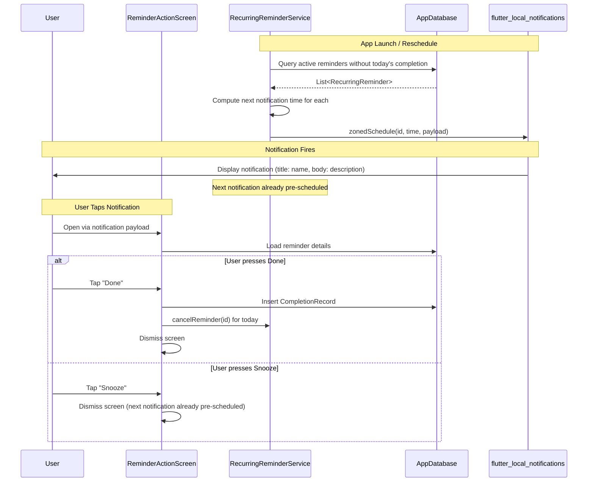
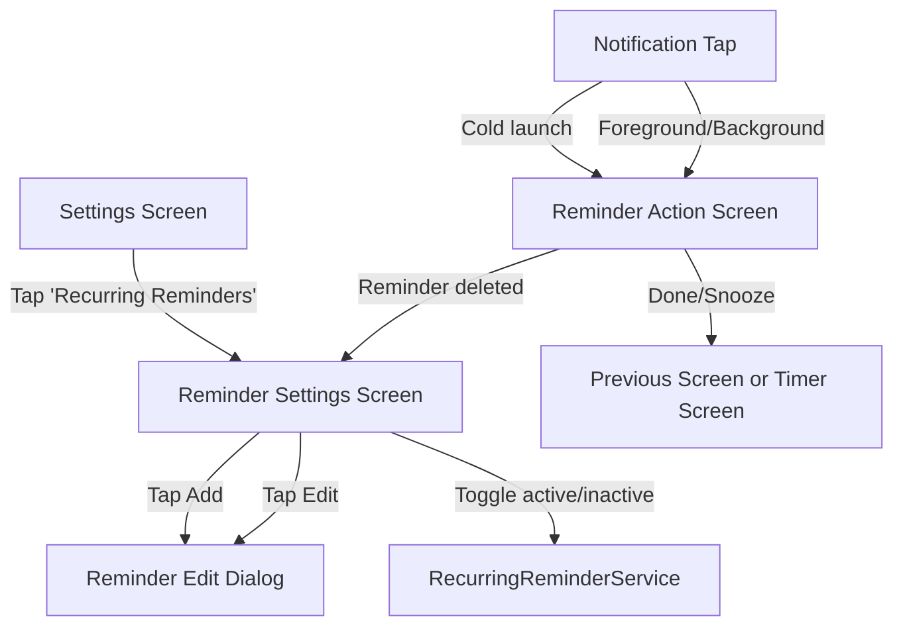

# Design Document: Recurring Reminders

## Overview

Recurring Reminders extends the TimeLog Flutter app with configurable daily recurring reminders for habits and tasks (e.g., take medication, exercise, practice English). Each reminder defines a time window and repeat interval; notifications fire at regular intervals within that window until the user marks the task as done or the window expires. The cycle resets daily.

The feature integrates into the existing app architecture: Drift for persistence, Riverpod for state management, and `flutter_local_notifications` for scheduling. Users manage reminders from a sub-screen within Settings and interact with triggered reminders via a dedicated action screen launched from notification taps.

### Key Design Decisions

| Decision | Choice | Rationale |
|----------|--------|-----------|
| Database | Extend existing Drift `AppDatabase` with new tables | Single database file, shared migrations, consistent data access patterns |
| Notification scheduling | 6-hour lookahead batch scheduling via `flutter_local_notifications` | Schedules all notifications for the next 6 hours on each app launch; ensures notifications fire even if user ignores them; no need to open app more than once per 6h; cancel remaining on "Done"; deduplication prevents double-scheduling; respects iOS 64-notification limit with a practical cap of 50 |
| Overnight windows | Window spans into next calendar day when start ≥ end | Simple minutes-from-midnight comparison; no midnight reset interruption |
| Active days storage | 7-bit bitmask in integer column | Compact, query-friendly, no join table needed |
| Repeat interval | Constrained enum (30, 60, 120, 180, 240 min) | Prevents unreasonable intervals; aligns with typical habit frequencies |
| Notification ID scheme | `(reminderId × 100) + slotIndex + 2000` | Supports multiple notifications per reminder (batch scheduling); avoids collision with existing timer notification (ID 1001) |
| State management | Riverpod `AsyncNotifier` for reminder list | Reactive UI updates on CRUD operations; consistent with existing providers |

## Architecture

```
┌─────────────────────────────────────────────────────────────┐
│                    Flutter App (Dart)                         │
│                                                              │
│  ┌─────────────────┐  ┌──────────────┐  ┌───────────────┐  │
│  │ Reminder        │  │ Reminder     │  │ Reminder      │  │
│  │ Settings Screen │  │ Edit Dialog  │  │ Action Screen │  │
│  └───────┬─────────┘  └──────┬───────┘  └───────┬───────┘  │
│          │                    │                   │          │
│  ┌───────┴────────────────────┴───────────────────┴───────┐ │
│  │                  Riverpod Providers                      │ │
│  │  (recurringRemindersProvider, reminderActionProvider)   │ │
│  └──────────┬──────────────────────┬──────────────────────┘ │
│             │                      │                        │
│  ┌──────────┴───────────┐  ┌──────┴──────────────────────┐ │
│  │ RecurringReminderSvc  │  │ AppDatabase (Drift)         │ │
│  │ (scheduling logic)   │  │ (RecurringReminders,        │ │
│  │                      │  │  CompletionRecords tables)   │ │
│  └──────────┬───────────┘  └─────────────────────────────┘ │
│             │                                               │
│  ┌──────────┴───────────────────┐                          │
│  │ flutter_local_notifications   │                          │
│  │ (FlutterLocalNotificationsPlugin)                       │
│  └──────────────────────────────┘                          │
└─────────────────────────────────────────────────────────────┘
```

### Component Interaction Flow — Notification Lifecycle



### Navigation Flow



## Components and Interfaces

### RecurringReminderService

The core scheduling engine. Responsible for computing notification times, scheduling/cancelling via `flutter_local_notifications`, and handling the day-reset logic.

```dart
class RecurringReminderService {
  static const String channelId = 'recurring_reminders';
  static const String channelName = 'Recurring Reminders';
  static const int notificationIdOffset = 2000;

  final FlutterLocalNotificationsPlugin _plugin;  // Shared instance from ReminderService
  final AppDatabase _db;

  /// Schedule all notifications for a reminder within the next 6 hours.
  /// Computes interval-aligned times from now to now+6h (within window).
  /// Skips times that already have a pending notification (deduplication).
  Future<void> scheduleUpcoming(RecurringReminder reminder);

  /// Cancel all pending notifications for a reminder.
  Future<void> cancelReminder(int reminderId);

  /// Reschedule all active reminders (called on app launch).
  /// Skips reminders with completion records for today.
  Future<void> rescheduleAll();

  /// Compute all notification times within the next 6 hours for a reminder.
  /// Returns empty list if the window has ended, reminder is complete, or no times fall in the lookahead.
  List<DateTime> computeUpcomingNotificationTimes(RecurringReminder reminder, DateTime now);

  /// Check if today is an active day for the reminder.
  bool isActiveDay(int activeDaysBitmask, int weekday);

  /// Request notification permission. Returns true if granted.
  Future<bool> requestPermission();

  /// Check current permission status.
  Future<bool> hasPermission();

  /// Get notification ID for a specific scheduled time slot.
  /// Each reminder can have multiple scheduled notifications (batch scheduling).
  /// ID = (reminderId * 100) + slotIndex + notificationIdOffset
  /// where slotIndex is 0-based index within the day's interval grid.
  /// This supports up to 100 notifications per reminder per day (practical max ~48 for 30min interval).
  int getNotificationId(int reminderId, int slotIndex) =>
      (reminderId * 100) + slotIndex + notificationIdOffset;
}
```

### RecurringRemindersProvider

Riverpod `AsyncNotifier` managing the list of reminders displayed on the settings screen.

```dart
class RecurringRemindersNotifier extends AsyncNotifier<List<RecurringReminder>> {
  Future<List<RecurringReminder>> build();

  /// Create a new reminder and schedule its first notification.
  Future<void> addReminder(RecurringReminderCompanion data);

  /// Update an existing reminder and reschedule.
  Future<void> updateReminder(int id, RecurringReminderCompanion data);

  /// Delete a reminder and cancel its notifications.
  Future<void> deleteReminder(int id);

  /// Toggle active/inactive status.
  Future<void> toggleActive(int id);

  /// Manually mark a reminder as done for today (from the settings screen).
  /// Creates a CompletionRecord and cancels remaining notifications.
  Future<void> markDoneForToday(int id);

  /// Undo a manual completion for today (uncheck).
  /// Deletes the CompletionRecord and reschedules notifications.
  Future<void> undoCompletionForToday(int id);
}
```

### ReminderActionProvider

Manages the state for the Reminder Action Screen.

```dart
class ReminderActionNotifier extends StateNotifier<ReminderActionState> {
  /// Mark the reminder as done for today.
  Future<void> markDone(int reminderId);

  /// Snooze the reminder.
  Future<void> snooze(int reminderId);
}

class ReminderActionState {
  final RecurringReminder? reminder;
  final bool isLoading;
  final String? error;
}
```

### Database Extensions (AppDatabase)

New methods added to the existing `AppDatabase`:

```dart
// --- RecurringReminders CRUD ---
Future<List<RecurringReminder>> getAllReminders();
Stream<List<RecurringReminder>> watchAllReminders();
Future<int> insertReminder(RecurringRemindersCompanion entry);
Future<bool> updateReminder(RecurringRemindersCompanion entry);
Future<int> deleteReminder(int id);
Future<RecurringReminder?> getReminderById(int id);

// --- CompletionRecords ---
Future<int> insertCompletionRecord(CompletionRecordsCompanion entry);
Future<bool> hasCompletionForToday(int reminderId, String todayDate);
Future<int> deleteCompletionForToday(int reminderId, String todayDate);
Future<List<CompletionRecord>> getCompletionsByReminder(int reminderId);
Future<List<CompletionRecord>> getCompletionsByDateRange(
  int reminderId, String startDate, String endDate,
);
```

### Notification Payload Contract

The notification payload encodes the reminder ID for routing on tap:

```dart
// Payload format: "recurring_reminder:<id>"
const String recurringReminderPayloadPrefix = 'recurring_reminder:';

// Parsing
int? parseReminderIdFromPayload(String? payload) {
  if (payload == null || !payload.startsWith(recurringReminderPayloadPrefix)) {
    return null;
  }
  return int.tryParse(payload.substring(recurringReminderPayloadPrefix.length));
}
```

### Time Window Computation

Core scheduling logic for computing notification times:

```dart
/// Computes all notification times within the next 6 hours, aligned to the interval grid.
/// Grid: start, start + interval, start + 2*interval, ...
/// Returns empty list if window has ended, reminder is completed, or no times in lookahead.
List<DateTime> computeUpcomingNotificationTimes({
  required int startMinutes,      // Minutes from midnight (0-1439)
  required int endMinutes,        // Minutes from midnight (0-1439)
  required int intervalMinutes,   // 30, 60, 120, 180, or 240
  required DateTime now,
  required bool hasCompletionToday,
}) {
  if (hasCompletionToday) return [];

  final lookaheadEnd = now.add(const Duration(hours: 6));

  // Handle overnight window (start >= end)
  // Compute absolute start/end DateTimes for today's window
  // Collect all grid-aligned times that are >= now AND < min(windowEnd, lookaheadEnd)
  // Return list of DateTimes to schedule (deduplicated against already-pending)
}
```

### Platform Notification Limits

iOS allows a maximum of 64 scheduled local notifications per app. To stay safely within this limit while leaving room for the daily reminder notification and potential future features, the service enforces a practical cap of **50 scheduled recurring reminder notifications** at any given time. If the total across all active reminders would exceed 50, reminders are prioritized by earliest start time.

### 6-Hour Lookahead Strategy

Instead of scheduling an entire day's notifications at once, the service schedules only those falling within the **next 6 hours** from the current time. This approach:
- Reduces the number of scheduled notifications at any point (well within the 50 cap)
- Works reliably as long as the user opens the app at least once every 6 hours (natural usage pattern for a timer app)
- Avoids wasting notification slots on far-future times that may be cancelled by "Done"
- Each app launch triggers `rescheduleAll()` which computes and schedules upcoming notifications, skipping any that are already pending (deduplication by reminder ID + scheduled time)

## Data Models

### RecurringReminders Table (Drift)

```dart
@DataClassName('RecurringReminder')
class RecurringReminders extends Table {
  IntColumn get id => integer().autoIncrement()();
  TextColumn get name => text().withLength(min: 1, max: 100)();
  TextColumn get description => text().withLength(min: 0, max: 300).nullable()();
  IntColumn get startTime => integer()();       // Minutes from midnight, 0-1439
  IntColumn get endTime => integer()();         // Minutes from midnight, 0-1439
  IntColumn get repeatInterval => integer()();  // Minutes: 30, 60, 120, 180, 240
  IntColumn get activeDays => integer()();      // 7-bit bitmask (bit 0 = Monday)
  BoolColumn get isActive => boolean().withDefault(const Constant(true))();
}
```

### CompletionRecords Table (Drift)

```dart
@DataClassName('CompletionRecord')
class CompletionRecords extends Table {
  IntColumn get id => integer().autoIncrement()();
  IntColumn get reminderId => integer().references(RecurringReminders, #id)();
  TextColumn get completionDate => text()();      // ISO 8601 date "YYYY-MM-DD"
  TextColumn get completionTimestamp => text()();  // ISO 8601 "YYYY-MM-DDTHH:mm:ss"
}
```

### Active Days Bitmask Encoding

```dart
/// Bit positions: 0=Monday, 1=Tuesday, ..., 6=Sunday
/// All days = 0b1111111 = 127
/// Mon+Wed+Fri = 0b0010101 = 21

int encodeDays(Set<int> weekdays) {
  // weekdays: 1=Monday, 7=Sunday (Dart DateTime.weekday convention)
  int mask = 0;
  for (final day in weekdays) {
    mask |= (1 << (day - 1));
  }
  return mask;
}

Set<int> decodeDays(int mask) {
  final days = <int>{};
  for (int i = 0; i < 7; i++) {
    if (mask & (1 << i) != 0) {
      days.add(i + 1);
    }
  }
  return days;
}

bool isDayActive(int mask, int weekday) => (mask & (1 << (weekday - 1))) != 0;
```

### RecurringReminderFormData (UI State)

```dart
class ReminderFormData {
  final String name;
  final String? description;
  final TimeOfDay startTime;
  final TimeOfDay endTime;
  final int repeatIntervalMinutes;
  final Set<int> activeDays;    // 1-7 (Monday-Sunday)
  final bool isActive;

  bool get isValid =>
      name.trim().isNotEmpty && activeDays.isNotEmpty;

  RecurringRemindersCompanion toCompanion();
}
```

### Database Migration

Increment `schemaVersion` from 5 to 6:

```dart
@override
int get schemaVersion => 6;

@override
MigrationStrategy get migration => MigrationStrategy(
  onCreate: (Migrator m) async {
    await m.createAll();
  },
  onUpgrade: (Migrator m, int from, int to) async {
    // ... existing migrations ...
    if (from < 6) {
      await m.createTable(recurringReminders);
      await m.createTable(completionRecords);
    }
  },
);
```


## Correctness Properties

*A property is a characteristic or behavior that should hold true across all valid executions of a system — essentially, a formal statement about what the system should do. Properties serve as the bridge between human-readable specifications and machine-verifiable correctness guarantees.*

### Property 1: Reminder list ordering by start time

*For any* set of Recurring_Reminders in the database, querying all reminders SHALL return them ordered by `startTime` ascending (minutes from midnight).

**Validates: Requirements 1.1**

### Property 2: Reminder data round-trip preservation

*For any* valid Recurring_Reminder (name 1–100 chars, description 0–300 chars, startTime 0–1439, endTime 0–1439, repeatInterval in {30, 60, 120, 180, 240}, activeDays 1–127, isActive boolean), inserting into the database and reading back SHALL produce a record with identical field values.

**Validates: Requirements 1.5, 9.1**

### Property 3: Cascade delete removes all associated completion records

*For any* Recurring_Reminder with any number of associated Completion_Records, deleting the reminder SHALL result in zero Completion_Records referencing that reminder's ID remaining in the database.

**Validates: Requirements 1.7, 8.3, 9.3**

### Property 4: Whitespace-only name invalidates form

*For any* string composed entirely of whitespace characters (spaces, tabs, newlines, or empty), the reminder form validation SHALL reject it (isValid returns false), preventing save.

**Validates: Requirements 2.2**

### Property 5: Overnight window duration computation

*For any* time window where startTime ≥ endTime (in minutes from midnight), the effective window duration SHALL equal `(1440 - startTime) + endTime` minutes, representing a window that crosses midnight into the following day.

**Validates: Requirements 2.3, 4.7**

### Property 6: Notification times aligned to interval grid

*For any* active Recurring_Reminder with a given startTime and repeatInterval, and *for any* current time within the Time_Window on an active day with no completion record, ALL computed notification times SHALL equal `startTime + N × repeatInterval` for non-negative integers N, SHALL be ≥ the current time, SHALL be < the window end time, and SHALL be < current time + 6 hours. The list SHALL be ordered ascending and contain no duplicates.

**Validates: Requirements 4.1, 4.2, 4.3**

### Property 7: No scheduling past window end

*For any* Recurring_Reminder and *any* current time that is past the Time_Window end for today, `computeUpcomingNotificationTimes` SHALL return an empty list (no notifications scheduled for today).

**Validates: Requirements 4.3**

### Property 8: No scheduling on non-active day

*For any* Recurring_Reminder and *any* current day whose weekday bit is not set in the activeDays bitmask, `computeUpcomingNotificationTimes` SHALL return an empty list for that day.

**Validates: Requirements 4.5**

### Property 9: No scheduling for inactive reminders

*For any* Recurring_Reminder where isActive is false, regardless of the current time or day, `computeUpcomingNotificationTimes` SHALL return an empty list.

**Validates: Requirements 3.4**

### Property 10: Notification content construction

*For any* Recurring_Reminder, the notification title SHALL equal the reminder's name, and the notification body SHALL equal the reminder's description if non-null and non-empty, or "Klepni pro otevření" otherwise.

**Validates: Requirements 5.1**

### Property 11: Completion record contains correct date and timestamp

*For any* Recurring_Reminder marked as done at time T, the resulting Completion_Record SHALL have `completionDate` equal to the ISO 8601 date portion of T ("YYYY-MM-DD") and `completionTimestamp` equal to the ISO 8601 datetime of T.

**Validates: Requirements 6.2, 8.1**

### Property 12: Completion record blocks further scheduling

*For any* Recurring_Reminder that has a Completion_Record with today's date, `computeUpcomingNotificationTimes` SHALL return an empty list regardless of the current time or window configuration.

**Validates: Requirements 6.4, 10.2**

### Property 13: Snooze dismisses without scheduling

*For any* Recurring_Reminder, pressing "Snooze" SHALL dismiss the Reminder_Action_Screen without scheduling any additional notification or creating any Completion_Record, relying on the pre-scheduled batch notifications for subsequent reminders.

**Validates: Requirements 7.1, 7.2**

### Property 14: Notification ID uniqueness across batch

*For any* set of active Recurring_Reminders scheduled via batch scheduling, ALL generated notification IDs SHALL be unique (no two notifications share the same ID), computed as `(reminderId × 100) + slotIndex + 2000`.

**Validates: Requirements 11.3**

### Property 15: Date range query returns correct records in order

*For any* set of Completion_Records and *any* date range [startDate, endDate], querying by that range SHALL return exactly those records whose completionDate falls within the inclusive range, ordered by completionDate ascending.

**Validates: Requirements 8.4**

## Error Handling

### Database Errors

| Scenario | Behavior |
|----------|----------|
| Create/Update reminder fails | Show error message on the Reminder_Edit_Dialog, preserve all form input, do not dismiss dialog |
| Delete reminder fails | Show error message, keep reminder in the list |
| Toggle active/inactive fails | Revert toggle to previous state, show error snackbar |
| Completion record write fails | Show error on Reminder_Action_Screen, do NOT dismiss screen, do NOT cancel notifications |
| Database initialization fails (migration) | App starts normally; reminder features show error state with retry option |

### Notification Scheduling Errors

| Scenario | Behavior |
|----------|----------|
| Permission denied | Do not schedule any notifications, show message indicating notifications are disabled on the settings screen |
| Permission previously denied, now granted | Proceed normally with scheduling on next app launch |
| Individual schedule call fails | Log warning, attempt on next trigger (app launch or next interval) |
| Cancel call fails | Log warning, notification may fire once more; next cycle will correct |

### Navigation Edge Cases

| Scenario | Behavior |
|----------|----------|
| Notification tap for deleted reminder | Navigate to Reminder_Settings_Screen instead of Action Screen |
| Cold launch with reminder payload | Initialize app fully, then navigate to Reminder_Action_Screen |
| Dismiss Action Screen with no history | Navigate to Timer_Screen (home) |

### Data Integrity

| Scenario | Behavior |
|----------|----------|
| Duplicate completion record attempt (same reminder + date) | Uniqueness constraint prevents duplicate; handle gracefully (treat as already done) |
| Reminder ID in notification payload doesn't exist in DB | Treat as deleted reminder case — navigate to settings |
| activeDays bitmask is 0 (no days selected) | Prevented by UI validation; if somehow persisted, treat as inactive |

## Testing Strategy

### Dual Testing Approach

- **Unit tests:** Verify specific scenarios, error handling, UI widget behavior, and integration points
- **Property-based tests:** Verify universal invariants of the scheduling logic, data layer, and validation rules

### Property-Based Testing Configuration

- **Library:** `dart_check` (Dart PBT library, already used in the project)
- **Iterations:** Minimum 100 per property test
- **Tag format:** `Feature: recurring-reminders, Property {number}: {property_text}`

### Test Organization

```
test/
├── unit/
│   ├── recurring_reminder_service_test.dart    # Scheduling, cancellation, snooze
│   ├── reminder_database_test.dart             # CRUD, cascade delete, queries
│   ├── reminder_form_validation_test.dart      # Name validation, active days
│   ├── active_days_bitmask_test.dart           # Encode/decode bitmask
│   └── notification_content_test.dart          # Title/body construction
│
├── property/
│   ├── reminder_ordering_property_test.dart        # Property 1: Start time ordering
│   ├── reminder_roundtrip_property_test.dart       # Property 2: DB round-trip
│   ├── cascade_delete_property_test.dart           # Property 3: Cascade delete
│   ├── whitespace_validation_property_test.dart    # Property 4: Whitespace rejection
│   ├── overnight_window_property_test.dart         # Property 5: Overnight duration
│   ├── interval_grid_property_test.dart            # Property 6: Grid-aligned scheduling
│   ├── past_window_property_test.dart              # Property 7: No scheduling past end
│   ├── non_active_day_property_test.dart           # Property 8: No scheduling wrong day
│   ├── inactive_reminder_property_test.dart        # Property 9: Inactive → no scheduling
│   ├── notification_content_property_test.dart     # Property 10: Content construction
│   ├── completion_record_property_test.dart        # Property 11: Correct date/timestamp
│   ├── completion_blocks_property_test.dart        # Property 12: Completion blocks scheduling
│   ├── snooze_scheduling_property_test.dart        # Property 13: Snooze dismisses
│   ├── notification_id_uniqueness_property_test.dart # Property 14: ID uniqueness
│   └── date_range_query_property_test.dart         # Property 15: Date range query
│
├── widget/
│   ├── reminder_settings_screen_test.dart      # List display, empty state, toggle
│   ├── reminder_edit_dialog_test.dart          # Form fields, defaults, validation
│   ├── reminder_action_screen_test.dart        # Done/Snooze buttons, dismiss
│   └── delete_confirmation_test.dart           # Confirmation dialog
│
└── integration/
    ├── reminder_lifecycle_test.dart            # Create → notify → done → reset
    ├── app_launch_reschedule_test.dart         # Rescheduling on launch
    └── notification_tap_navigation_test.dart   # Cold/warm launch navigation
```

### Key Unit Test Scenarios

1. **RecurringReminderService:** Schedule, cancel, reschedule flows with mocked `FlutterLocalNotificationsPlugin`
2. **Overnight window:** Window 22:00–02:00 fires notifications across midnight boundary
3. **Snooze edge cases:** Snooze at window boundary, snooze exactly at end time
4. **Toggle revert:** Database failure during toggle reverts UI state
5. **Permission flow:** First reminder triggers permission request; denied prevents all scheduling

### Property Test Implementation Notes

Each property test must:
1. Use `dart_check` generators for random input
2. Run minimum 100 iterations
3. Reference the design property number in a comment tag
4. Be isolated (no shared mutable state between iterations)

Example pattern for the scheduling property:
```dart
// Feature: recurring-reminders, Property 6: Notification times aligned to interval grid
property('all notification times are on interval grid within 6h lookahead', () {
  forAll(
    reminderGen(),  // Generates valid reminder configs
    dateTimeWithinWindowGen(),  // Generates "now" within the window
    (reminder, now) {
      final times = computeUpcomingNotificationTimes(
        startMinutes: reminder.startTime,
        endMinutes: reminder.endTime,
        intervalMinutes: reminder.repeatInterval,
        now: now,
        hasCompletionToday: false,
      );
      final lookaheadEnd = now.add(const Duration(hours: 6));
      expect(times, isNotEmpty);
      for (final t in times) {
        final minutesFromStart = t.difference(windowStart).inMinutes;
        expect(minutesFromStart % reminder.repeatInterval, equals(0));
        expect(t.isAfter(now) || t.isAtSameMomentAs(now), isTrue);
        expect(t.isBefore(lookaheadEnd), isTrue);
      }
      // Verify ascending order and no duplicates
      for (int i = 1; i < times.length; i++) {
        expect(times[i].isAfter(times[i - 1]), isTrue);
      }
    },
  );
});
```

### File Structure for New Code

```
lib/
├── data/
│   ├── recurring_reminder.dart         # RecurringReminders table definition
│   ├── completion_record.dart          # CompletionRecords table definition
│   └── database.dart                   # Updated: add tables, bump schema version
│
├── services/
│   └── recurring_reminder_service.dart # Scheduling engine
│
├── providers/
│   ├── recurring_reminders_provider.dart  # List + CRUD notifier
│   └── reminder_action_provider.dart      # Action screen state
│
└── ui/
    ├── screens/
    │   ├── reminder_settings_screen.dart  # Reminder list sub-screen
    │   └── reminder_action_screen.dart    # Done/Snooze screen
    └── widgets/
        ├── reminder_edit_dialog.dart      # Create/edit modal
        ├── reminder_card.dart             # Single reminder in list
        └── day_selector.dart              # Multi-select weekday chips
```
