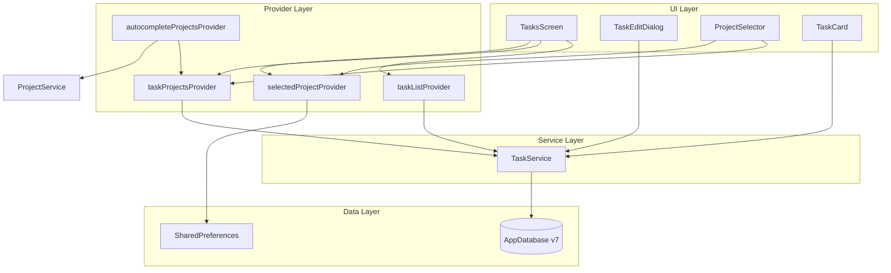

# Design Document: Task Management

## Overview

Task Management adds a dedicated "Úkoly" tab to the TimeLog app, providing a lightweight TODO list organized by projects. The feature integrates with the existing Drift database (schema v6 → v7), Riverpod state management, and the timer's project autocomplete. Completed tasks are automatically archived after 12 hours via a simple timestamp-comparison check that runs on app foreground/launch.

Key design decisions:
- **Archive timer via completedAt comparison** — no background isolate or actual Dart Timer; the service simply evaluates `now - completedAt > 12h` on lifecycle events
- **Task projects stored in Drift** — separate from timer's ProjectService (SharedPreferences), but merged into autocomplete suggestions
- **Sort position as integer** — reordering reassigns contiguous integers to affected items
- **Last-viewed project in SharedPreferences** — lightweight persistence matching existing patterns

## Architecture



The architecture follows the existing app pattern: UI reads providers, providers delegate to services, services interact with the database directly via `AppDatabase` methods.

## Components and Interfaces

### Database Tables (lib/data/)

#### task_project.dart

```dart
import 'package:drift/drift.dart';

@DataClassName('TaskProject')
class TaskProjects extends Table {
  IntColumn get id => integer().autoIncrement()();
  TextColumn get name => text().withLength(min: 1, max: 100)();
  DateTimeColumn get createdAt => dateTime().withDefault(currentDateAndTime)();
}
```

#### task.dart

```dart
import 'package:drift/drift.dart';
import 'task_project.dart';

@DataClassName('TaskItem')
class Tasks extends Table {
  IntColumn get id => integer().autoIncrement()();
  TextColumn get title => text().withLength(min: 1, max: 200)();
  TextColumn get description => text().withLength(min: 0, max: 1000).nullable()();
  TextColumn get deadline => text().nullable()(); // ISO 8601 "YYYY-MM-DD"
  IntColumn get projectId =>
      integer().nullable().references(TaskProjects, #id, onDelete: KeyAction.cascade)();
  IntColumn get sortPosition => integer().withDefault(const Constant(0))();
  BoolColumn get isCompleted => boolean().withDefault(const Constant(false))();
  DateTimeColumn get completedAt => dateTime().nullable()();
  BoolColumn get isArchived => boolean().withDefault(const Constant(false))();
  DateTimeColumn get createdAt => dateTime().withDefault(currentDateAndTime)();
}
```

#### database.dart changes

Register both tables in `@DriftDatabase(tables: [..., TaskProjects, Tasks])`, bump `schemaVersion` to 7, and add migration:

```dart
if (from < 7) {
  await m.createTable(taskProjects);
  await m.createTable(tasks);
}
```

### TaskService (lib/services/task_service.dart)

```dart
class TaskService {
  final AppDatabase _db;

  TaskService(this._db);

  // --- Task Projects ---
  Future<List<TaskProject>> getAllProjects();
  Stream<List<TaskProject>> watchAllProjects();
  Future<int> createProject(String name);
  Future<void> deleteProject(int projectId);
  Future<List<String>> getProjectNames(); // For autocomplete merge

  // --- Tasks ---
  Future<List<TaskItem>> getTasksForProject(int? projectId, {bool includeArchived = false});
  Stream<List<TaskItem>> watchTasksForProject(int? projectId, {bool includeArchived = false});
  Future<int> createTask({
    required String title,
    String? description,
    String? deadline,
    int? projectId,
  });
  Future<void> updateTask(int taskId, {
    String? title,
    String? description,
    String? deadline,
  });
  Future<void> deleteTask(int taskId);

  // --- Ordering ---
  Future<void> reorder(int taskId, int newPosition, int? projectId);

  // --- Completion & Archiving ---
  Future<void> toggleComplete(int taskId);
  Future<void> archiveExpiredTasks(); // Called on foreground/launch
  Future<void> unarchiveTask(int taskId);
}
```

**Key implementation details:**

- `createTask` — queries current max `sortPosition` for the group (project or null), assigns `max + 1`
- `reorder` — fetches all tasks in the group ordered by sortPosition, removes the moved task, inserts at new index, then batch-updates sortPositions as contiguous integers (0, 1, 2, ...)
- `toggleComplete` — if currently incomplete: sets `isCompleted = true`, `completedAt = DateTime.now()`; if currently completed (not archived): sets `isCompleted = false`, `completedAt = null`
- `archiveExpiredTasks` — queries all tasks where `isCompleted = true AND isArchived = false AND completedAt IS NOT NULL`, filters those where `DateTime.now().difference(completedAt) >= 12 hours`, sets `isArchived = true`
- `unarchiveTask` — sets `isCompleted = false`, `completedAt = null`, `isArchived = false`, assigns sortPosition at end of group
- `deleteProject` — relies on cascade delete (FK constraint) to remove all associated tasks

### Provider Layer (lib/providers/task_providers.dart)

```dart
// Service singleton
final taskServiceProvider = Provider<TaskService>((ref) {
  final db = ref.watch(appDatabaseProvider);
  return TaskService(db);
});

// All projects (for selector)
final taskProjectsProvider = StreamProvider<List<TaskProject>>((ref) {
  final service = ref.watch(taskServiceProvider);
  return service.watchAllProjects();
});

// Selected project ID (null = Unassigned)
final selectedTaskProjectProvider = StateProvider<int?>((ref) => null);

// Show archived toggle
final showArchivedTasksProvider = StateProvider<bool>((ref) => false);

// Task list for current selection
final taskListProvider = StreamProvider<List<TaskItem>>((ref) {
  final service = ref.watch(taskServiceProvider);
  final projectId = ref.watch(selectedTaskProjectProvider);
  final showArchived = ref.watch(showArchivedTasksProvider);
  return service.watchTasksForProject(projectId, includeArchived: showArchived);
});

// Merged autocomplete suggestions for timer
final autocompleteProjectsProvider = FutureProvider<List<String>>((ref) async {
  final taskService = ref.watch(taskServiceProvider);
  final projectService = ref.watch(projectServiceProvider);
  final taskProjectNames = await taskService.getProjectNames();
  final timerProjects = await projectService.getKnownProjects();

  // Merge: task projects first, then timer projects, dedup case-insensitive
  final seen = <String>{};
  final merged = <String>[];
  for (final name in taskProjectNames) {
    if (seen.add(name.toLowerCase())) merged.add(name);
  }
  for (final name in timerProjects) {
    if (seen.add(name.toLowerCase())) merged.add(name);
  }
  return merged;
});
```

**Last-viewed project persistence** — handled inside `_MainShellState` or a dedicated initializer:
- On project selection change → `SharedPreferences.setInt('last_task_project_id', id)` or remove key for Unassigned
- On Tasks_Screen first display → read from SharedPreferences, validate project still exists, set `selectedTaskProjectProvider`

### UI Components

#### TasksScreen (lib/ui/screens/tasks_screen.dart)

- `ConsumerStatefulWidget` with lifecycle observer (`WidgetsBindingObserver`) to trigger `archiveExpiredTasks()` on resume
- Calls `archiveExpiredTasks()` in `initState` (via post-frame callback)
- Contains `ProjectSelector` at top, task list body (ReorderableListView.builder), FAB for add task
- Menu action "Zobrazit archivované úkoly" toggles `showArchivedTasksProvider`
- Empty state widget when task list is empty

#### ProjectSelector (lib/ui/widgets/project_selector.dart)

- Horizontal scrollable chip/tab bar or dropdown showing projects alphabetically + "Nepřiřazeno" last
- Add project button (+ icon) triggers create dialog
- Long-press or trailing icon on project chip triggers delete confirmation
- Reads `taskProjectsProvider`, writes `selectedTaskProjectProvider`

#### TaskEditDialog (lib/ui/widgets/task_edit_dialog.dart)

- Modal bottom sheet (same styling as existing Description_Prompt)
- Fields: title TextField (maxLength: 200), description TextField (maxLength: 1000, multiline), deadline date picker (clearable, today+)
- Save button disabled while title is empty/whitespace
- Returns the entered values; caller handles create/update via TaskService

#### TaskCard (lib/ui/widgets/task_card.dart)

- Rounded panel (theme.panel background, theme.border, borderRadius matching History)
- Checkbox (leading), title + deadline row, expand/collapse description on tap
- Completed: strikethrough + opacity 0.5
- Archived: no checkbox, unarchive action visible
- Drag handle icon (Icons.drag_handle, color: theme.dim) at trailing edge

### Navigation Changes (lib/app.dart, lib/ui/widgets/bottom_nav.dart)

**bottom_nav.dart** — insert new `_NavItem` at index 1:
```dart
_NavItem(
  icon: Icons.checklist_outlined,
  activeIcon: Icons.checklist,
  label: 'Úkoly',
  isActive: selectedIndex == 1,
  theme: theme,
  onTap: () => onTap(1),
),
```

Shift existing History/Stats/Settings indices to 2/3/4.

**app.dart** — add `TasksScreen()` at index 1 in `_screens` list, update Statistics invalidation from `index == 2` check to `index == 3`.

### Timer Integration

The existing `Autocomplete<String>` widgets in `description_sheet.dart`, `edit_sheet.dart`, and `manual_entry_sheet.dart` currently load projects from `ProjectService`. The change:

1. Replace direct `ProjectService.getKnownProjects()` calls with reading `autocompleteProjectsProvider`
2. The provider handles merging and deduplication
3. The save flow remains unchanged — project name is stored as plain string in TimeEntry and persisted to ProjectService (so it appears in recently-used)

### Archive Timer Mechanism

There is no persistent background timer. The "12-hour archive" works as follows:

1. **On complete** — `completedAt` is set to `DateTime.now()`
2. **On foreground/launch** — `TaskService.archiveExpiredTasks()` is called, which queries `SELECT * FROM tasks WHERE is_completed = 1 AND is_archived = 0 AND completed_at IS NOT NULL` and archives any where `now - completedAt >= 12h`
3. **On Tasks_Screen resume** — same check via `WidgetsBindingObserver.didChangeAppLifecycleState`
4. **Uncomplete within window** — clears `completedAt`, so the task won't be picked up by the archive check

This approach is simple, requires no background execution, and is consistent with iOS app lifecycle (no guaranteed background processing).

## Data Models

### TaskProject (generated by Drift)

| Field | Type | Constraints |
|-------|------|-------------|
| id | int | auto-increment PK |
| name | String | 1–100 chars |
| createdAt | DateTime | default now |

### TaskItem (generated by Drift)

| Field | Type | Constraints |
|-------|------|-------------|
| id | int | auto-increment PK |
| title | String | 1–200 chars |
| description | String? | 0–1000 chars, nullable |
| deadline | String? | nullable, ISO 8601 date |
| projectId | int? | nullable, FK → TaskProjects (cascade delete) |
| sortPosition | int | default 0 |
| isCompleted | bool | default false |
| completedAt | DateTime? | nullable |
| isArchived | bool | default false |
| createdAt | DateTime | default now |

### SharedPreferences Keys

| Key | Type | Purpose |
|-----|------|---------|
| `last_task_project_id` | int? | Last selected project ID (absent = Unassigned) |

## Correctness Properties

*A property is a characteristic or behavior that should hold true across all valid executions of a system — essentially, a formal statement about what the system should do. Properties serve as the bridge between human-readable specifications and machine-verifiable correctness guarantees.*

### Property 1: Project selector ordering

*For any* list of Task_Projects in the database, the Project_Selector SHALL display them sorted alphabetically by name (case-insensitive), with the Unassigned_Group always appearing as the last entry.

**Validates: Requirements 2.1**

### Property 2: Whitespace-only input disables action buttons

*For any* string composed entirely of whitespace characters (spaces, tabs, newlines), both the project creation confirm button and the task save button SHALL remain disabled.

**Validates: Requirements 2.3, 3.3**

### Property 3: Project creation persists to database

*For any* valid project name (1–100 non-whitespace-only characters), creating a project SHALL result in the Task_Database containing a TaskProject with that exact name and the project appearing in the project list.

**Validates: Requirements 2.4**

### Property 4: Cascade delete removes project and all associated tasks

*For any* Task_Project with any number of associated Tasks (0 or more), deleting the project SHALL result in both the project and all its tasks being removed from the Task_Database.

**Validates: Requirements 2.7, 8.3**

### Property 5: New task sort position at end of group

*For any* group (project or Unassigned) containing N tasks, creating a new task SHALL assign it a sort position greater than all existing tasks in that group.

**Validates: Requirements 3.4**

### Property 6: Task update persistence

*For any* existing Task and any valid combination of updated field values (title 1–200 chars, description 0–1000 chars or null, deadline as valid ISO date or null), updating the task SHALL result in the Task_Database reflecting exactly those new values while preserving unchanged fields.

**Validates: Requirements 3.6**

### Property 7: Task list filtering and ordering

*For any* set of tasks distributed across multiple projects, selecting a specific project SHALL display only the tasks belonging to that project (or tasks with null projectId for Unassigned), ordered by sortPosition ascending.

**Validates: Requirements 4.1**

### Property 8: Date formatting

*For any* valid date, the formatting function SHALL produce a string matching the pattern "d. M. yyyy" (day without leading zero, dot, space, month without leading zero, dot, space, four-digit year).

**Validates: Requirements 4.3**

### Property 9: Reorder produces valid contiguous positions

*For any* list of N tasks in a group and any valid move (source index, destination index where 0 ≤ indices < N), after reordering, all tasks in the group SHALL have contiguous sort positions (0, 1, 2, ..., N-1) reflecting the new visual order.

**Validates: Requirements 4.5**

### Property 10: Mark complete sets status and timestamp

*For any* incomplete, non-archived task, toggling completion SHALL set `isCompleted = true` and `completedAt` to a timestamp within 1 second of the current time.

**Validates: Requirements 5.1**

### Property 11: Archive check archives expired tasks

*For any* task where `isCompleted = true`, `isArchived = false`, and `completedAt` is more than 12 hours in the past, calling `archiveExpiredTasks()` SHALL set `isArchived = true` for that task and SHALL NOT archive tasks whose completedAt is less than 12 hours ago.

**Validates: Requirements 5.3**

### Property 12: Restoring tasks clears completion fields

*For any* completed (non-archived) task, uncompleting it SHALL set `isCompleted = false` and `completedAt = null`. *For any* archived task, unarchiving it SHALL set `isCompleted = false`, `completedAt = null`, and `isArchived = false`.

**Validates: Requirements 5.4, 5.10**

### Property 13: Default view excludes archived tasks

*For any* set of tasks in a group including both archived and non-archived tasks, the default task list (showArchived = false) SHALL contain zero archived tasks.

**Validates: Requirements 5.6**

### Property 14: Archived tasks ordered by completion timestamp descending

*For any* set of archived tasks displayed in the archive view, they SHALL be ordered by `completedAt` descending (most recently completed first).

**Validates: Requirements 5.7**

### Property 15: Merged autocomplete list — unique names, task projects first

*For any* combination of Task_Project names and ProjectService names, the merged suggestion list SHALL contain each unique name exactly once (case-insensitive deduplication), with all Task_Project-sourced names appearing before ProjectService-sourced names.

**Validates: Requirements 7.1, 7.2**

### Property 16: Deleting a task project does not affect time entries

*For any* Task_Project whose name matches the project field of existing TimeEntry records, deleting the Task_Project SHALL leave all TimeEntry records with that project name unchanged in the database.

**Validates: Requirements 7.4**

### Property 17: Project selection round-trip persistence

*For any* project selection (specific project ID or null for Unassigned), persisting to SharedPreferences and reading it back SHALL return the same value.

**Validates: Requirements 6.1**

## Error Handling

| Scenario | Handling |
|----------|----------|
| DB write fails (create/update/delete project or task) | Catch exception, show Czech SnackBar error ("Nepodařilo se ..."), retain previous UI state |
| DB fails during reorder | Catch exception, revert list to pre-drag order, show error SnackBar |
| Persisted project ID refers to deleted project | Fall back to Unassigned_Group, update SharedPreferences to null |
| SharedPreferences read fails or returns invalid data | Default to Unassigned_Group |
| Date picker — past date selection | Prevent selection via `firstDate: DateTime.now()` (DatePicker constraint) |

All error messages are in Czech, inline in the widget, matching existing app patterns (no i18n framework).

## Testing Strategy

### Unit Tests (example-based)

- Navigation: verify 5 tabs in correct order, correct icons/labels
- UI interactions: dialog appearance, pre-filled fields, expand/collapse
- Visual: completed task strikethrough, archived task no checkbox
- Empty states: correct messages displayed
- Czech strings: verify correct labels

### Property-Based Tests

Property-based testing is appropriate for this feature because the service layer contains pure logic (sorting, filtering, merging, timestamp comparison) with clear input/output behavior and wide input spaces.

**Library**: `glados` (Dart property-based testing library available on pub.dev)

**Configuration**: minimum 100 iterations per property test.

**Tag format**: `// Feature: task-management, Property {N}: {title}`

Properties to implement:
1. Project selector ordering
2. Whitespace validation
3. Project creation persistence (with in-memory DB)
4. Cascade delete
5. Sort position at end
6. Task update persistence
7. Filtering and ordering
8. Date formatting
9. Reorder produces contiguous positions
10. Mark complete sets status/timestamp
11. Archive check logic
12. Restore clears fields
13. Default view excludes archived
14. Archived ordering
15. Merged autocomplete dedup + ordering
16. Task project deletion vs. time entries
17. Project selection round-trip

### Integration Tests

- App lifecycle: foreground triggers archive check
- Sort position persists across restart
- Timer autocomplete shows merged projects in running app
- SharedPreferences last-viewed project on launch

### Test Infrastructure

- Use `AppDatabase.forTesting(NativeDatabase.memory())` for all DB tests
- Use `SharedPreferences.setMockInitialValues({})` for preference tests
- Widget tests use `ProviderContainer` + `UncontrolledProviderScope`
