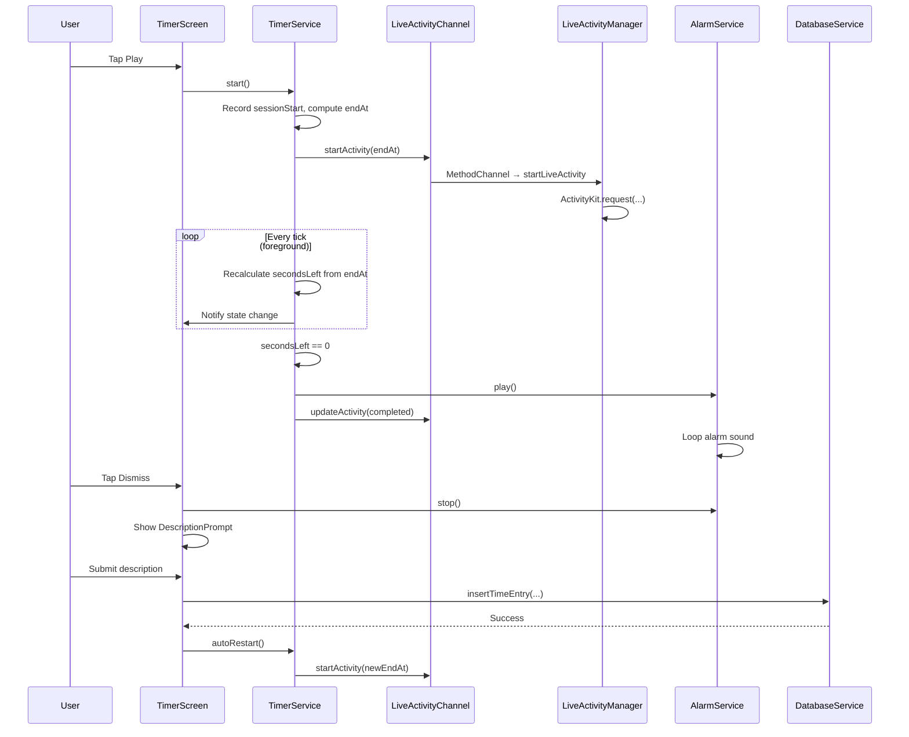

# Design Document: TimeLog Timer

## Overview

TimeLog is a Flutter iOS countdown timer app that implements a focused work interval pattern. The user starts a configurable timer (default 20 minutes), works until the alarm fires, then describes what they accomplished. The entry is saved locally, the timer auto-restarts, and the cycle continues.

The app consists of two main screens (Timer, History) connected via bottom tab navigation. A native iOS Widget Extension provides Live Activity support for lock screen and Dynamic Island countdown display. All data is persisted in a local SQLite database.

### Key Design Decisions

| Decision | Choice | Rationale |
|----------|--------|-----------|
| State management | `flutter_riverpod` | Lightweight, testable, supports async providers and service injection |
| Database | `drift` (SQLite) | Type-safe, reactive queries, migration support, code generation |
| Platform channels | `MethodChannel` + `EventChannel` | Required for ActivityKit Live Activities (no Flutter plugin exists) |
| Timer strategy | Store absolute `endAt` timestamp | Resilient to backgrounding — recalculate remaining on foreground |
| Audio | `audioplayers` package | Cross-platform, supports looping, no native code needed for alarm sound |
| UI rendering | `CustomPainter` for ring | SVG-like circular progress with glow, stroke caps, and animation |

## Architecture

```
┌─────────────────────────────────────────────────────────┐
│                   Flutter App (Dart)                      │
│                                                          │
│  ┌────────────┐  ┌────────────┐  ┌──────────────────┐  │
│  │ Timer      │  │ History    │  │ Description      │  │
│  │ Screen     │  │ Screen     │  │ Bottom Sheet     │  │
│  └─────┬──────┘  └─────┬──────┘  └────────┬─────────┘  │
│        │                │                   │            │
│  ┌─────┴────────────────┴───────────────────┴─────────┐ │
│  │              Riverpod Providers                      │ │
│  │  (timerProvider, historyProvider, themeProvider)     │ │
│  └──────────┬──────────────┬──────────────┬───────────┘ │
│             │              │              │              │
│  ┌──────────┴───┐  ┌──────┴──────┐  ┌───┴───────────┐ │
│  │ TimerService  │  │ AlarmService│  │ DatabaseService│ │
│  └──────────┬───┘  └─────────────┘  └───────────────┘ │
│             │                                           │
│  ┌──────────┴──────────────────┐                       │
│  │  LiveActivityChannel        │                       │
│  │  (MethodChannel bridge)     │                       │
│  └──────────┬──────────────────┘                       │
└─────────────┼───────────────────────────────────────────┘
              │ Platform Channel (MethodChannel)
┌─────────────┼───────────────────────────────────────────┐
│             ▼        iOS Native (Swift)                   │
│  ┌─────────────────────────────┐                        │
│  │  AppDelegate / FlutterEngine │                        │
│  │  MethodChannel handler       │                        │
│  └──────────┬──────────────────┘                        │
│             │                                            │
│  ┌──────────┴──────────────────┐                        │
│  │  LiveActivityManager.swift   │                        │
│  │  (ActivityKit API)           │                        │
│  └─────────────────────────────┘                        │
│                                                          │
│  ┌─────────────────────────────────────────────────┐    │
│  │  TimeLogWidgetExtension (Widget target)          │    │
│  │  - TimeLogWidgetBundle.swift                     │    │
│  │  - TimeLogLiveActivity.swift (ActivityAttributes)│    │
│  │  - LockScreenView / DynamicIslandView            │    │
│  └─────────────────────────────────────────────────┘    │
└──────────────────────────────────────────────────────────┘
```

### Component Interaction Flow



## Components and Interfaces

### TimerService

The core timer engine. Manages state transitions and countdown logic.

```dart
enum TimerStatus { idle, running, paused, ringing }

class TimerState {
  final TimerStatus status;
  final int totalSeconds;       // Duration in seconds (from config)
  final int secondsLeft;        // Remaining countdown seconds
  final DateTime? sessionStart; // When current session began
  final DateTime? endAt;        // Absolute time when timer will reach zero
}

abstract class TimerService {
  TimerState get state;
  Stream<TimerState> get stateStream;

  void start();
  void pause();
  void resume();
  void stop();
  void finishNow();
  void autoRestart();
}
```

**Background strategy:** On `start()`, `endAt = DateTime.now() + remainingDuration` is stored. A periodic `Timer` (1 second) recalculates `secondsLeft = endAt - now`. On app resume from background, `WidgetsBindingObserver.didChangeAppLifecycleState` triggers immediate recalculation. If `endAt` has passed while backgrounded, transition to `ringing`.

### AlarmService

Manages alarm audio playback.

```dart
abstract class AlarmService {
  bool get isPlaying;
  Future<void> play();   // Start looped alarm sound
  Future<void> stop();   // Stop within 200ms
}
```

Implementation uses `audioplayers` with `ReleaseMode.loop`. The alarm audio file is bundled as an asset.

### LiveActivityChannel

Flutter-side bridge to the native iOS Live Activity system.

```dart
abstract class LiveActivityChannel {
  Future<bool> startActivity({
    required DateTime endAt,
    required int totalSeconds,
  });
  Future<void> updateActivity({
    required LiveActivityUpdate update,
  });
  Future<void> endActivity();
  Future<bool> areActivitiesEnabled();
}

enum LiveActivityUpdate { paused, resumed, completed }
```

### DatabaseService

Manages SQLite operations via `drift`.

```dart
abstract class DatabaseService {
  Future<void> initialize();
  Future<int> insertTimeEntry(TimeEntryCompanion entry);
  Future<List<TimeEntry>> getEntriesForDay(DateTime day);
  Future<void> updateDescription(int id, String description);
  Future<void> deleteEntry(int id);
  Stream<List<TimeEntry>> watchEntriesForDay(DateTime day);
}
```

### ThemeService

Manages the active color theme.

```dart
enum AppTheme { ember, midnight, paper }

class ThemeData {
  final Color background;
  final Color text;
  final Color accent;
  final Color ink;
  final Color panel;
  final Color border;
  final Color track;
  final Color dim;
  final Color faint;
  final Color glow;
  final Color glowSoft;
}
```

### Platform Channel Contract

Channel name: `com.jablecnik.timelog/live_activity`

| Method (Flutter → iOS) | Arguments | Returns |
|------------------------|-----------|---------|
| `startLiveActivity` | `{ "endAt": int (epoch ms), "totalSeconds": int }` | `bool` (success) |
| `updateLiveActivity` | `{ "action": "pause" \| "resume" \| "complete", "secondsLeft": int? }` | `void` |
| `endLiveActivity` | `{}` | `void` |
| `areActivitiesEnabled` | `{}` | `bool` |

| Method (iOS → Flutter) | Arguments | Purpose |
|------------------------|-----------|---------|
| `onLockScreenAction` | `{ "action": "pause" \| "resume" \| "stop" }` | User tapped control on lock screen |

### iOS Widget Extension

The Widget Extension (`TimeLogWidgetExtension`) uses ActivityKit to render Live Activities:

```swift
struct TimeLogAttributes: ActivityAttributes {
    struct ContentState: Codable, Hashable {
        var endAt: Date        // countdown target
        var isPaused: Bool
        var isCompleted: Bool
        var secondsLeft: Int   // used when paused
    }
    var totalSeconds: Int
}
```

**Lock screen view:** Shows countdown using `Text(timerInterval:)` for system-managed live countdown (no push updates needed). Displays pause/resume and stop buttons as `Button` with intent.

**Dynamic Island:**
- Compact: Accent-colored timer icon + remaining time
- Expanded: Progress indicator + remaining time + controls

## Data Models

### TimeEntry (Database)

| Column | Type | Constraints |
|--------|------|-------------|
| `id` | `INTEGER` | Primary key, auto-increment |
| `startTime` | `TEXT` | ISO 8601 datetime, NOT NULL |
| `endTime` | `TEXT` | ISO 8601 datetime, NOT NULL |
| `description` | `TEXT` | Max 500 chars, NOT NULL |
| `createdAt` | `TEXT` | ISO 8601, default current timestamp |

```dart
@DataClassName('TimeEntry')
class TimeEntries extends Table {
  IntColumn get id => integer().autoIncrement()();
  TextColumn get startTime => text()();
  TextColumn get endTime => text()();
  TextColumn get description => text().withLength(min: 1, max: 500)();
  TextColumn get createdAt => text().withDefault(currentDateAndTime)();
}
```

### TimerState (In-memory)

```dart
@freezed
class TimerState with _$TimerState {
  const factory TimerState({
    @Default(TimerStatus.idle) TimerStatus status,
    @Default(1200) int totalSeconds,      // 20min default
    @Default(1200) int secondsLeft,
    DateTime? sessionStart,
    DateTime? endAt,
  }) = _TimerState;
}
```

### TimerConfig

```dart
class TimerConfig {
  static const int defaultDurationMinutes = 20;
  static const int minDurationMinutes = 1;
  static const int maxDurationMinutes = 1440;

  final int durationMinutes;

  factory TimerConfig({int? minutes}) {
    final m = minutes ?? defaultDurationMinutes;
    if (m < minDurationMinutes || m > maxDurationMinutes || m != m.roundToDouble()) {
      return TimerConfig._(defaultDurationMinutes);
    }
    return TimerConfig._(m);
  }

  const TimerConfig._(this.durationMinutes);

  int get totalSeconds => durationMinutes * 60;
}
```

### AppThemeData

```dart
class AppThemeData {
  final String name;
  final Color background;
  final Color text;
  final Color accent;
  final Color ink;
  final Color panel;
  final Color border;
  final Color track;
  final Color dim;
  final Color faint;
  final Color glow;
  final Color glowSoft;

  static const ember = AppThemeData(
    name: 'Ember',
    background: Color(0xFF1A1310),
    text: Color(0xFFEEE6DC),
    accent: Color(0xFFE88A66),
    ink: Color(0xFF1A120E),
    panel: Color(0x0BFFFFFF),      // rgba(255,255,255,0.045)
    border: Color(0x14FFFFFF),      // rgba(255,255,255,0.08)
    track: Color(0x12FFFFFF),       // rgba(255,255,255,0.07)
    dim: Color(0x8CEEE6DC),         // rgba(238,230,220,0.55)
    faint: Color(0x66EEE6DC),       // rgba(238,230,220,0.4)
    glow: Color(0x80E88A66),        // rgba(232,138,102,0.5)
    glowSoft: Color(0x99E88A66),    // rgba(232,138,102,0.6)
  );

  // midnight and paper defined similarly...
}
```

## Correctness Properties

*A property is a characteristic or behavior that should hold true across all valid executions of a system — essentially, a formal statement about what the system should do. Properties serve as the bridge between human-readable specifications and machine-verifiable correctness guarantees.*

### Property 1: Timer configuration validation

*For any* integer value, `TimerConfig` SHALL produce a duration equal to that value if it falls within [1, 1440], and SHALL produce 20 (the default) for any value outside that range or any non-integer value.

**Validates: Requirements 2.1, 2.4**

### Property 2: Time recalculation correctness

*For any* `endAt` timestamp and *any* current time, the recalculated `secondsLeft` SHALL equal `max(0, ceil((endAt - currentTime) / 1000))`, ensuring the timer remains accurate regardless of how long the app was backgrounded.

**Validates: Requirements 3.1**

### Property 3: Whitespace-only description rejection

*For any* string composed entirely of whitespace characters (spaces, tabs, newlines), the description validation SHALL reject it and the submit action SHALL be disabled.

**Validates: Requirements 6.4, 8.5**

### Property 4: Description trimming on save

*For any* non-empty, non-whitespace-only string of up to 500 characters, saving a Time_Entry SHALL store the description with leading and trailing whitespace removed, and the stored value SHALL equal the original string trimmed.

**Validates: Requirements 6.5**

### Property 5: History entries sorted by start time descending

*For any* list of Time_Entry records returned by a query (all entries or day-filtered), the list SHALL be ordered such that each entry's start time is greater than or equal to the start time of the following entry.

**Validates: Requirements 8.1, 12.8**

### Property 6: Description display truncation

*For any* Time_Entry description longer than 50 characters, the History_Screen display SHALL show exactly the first 50 characters followed by "…". *For any* description of 50 characters or fewer, the display SHALL show the full description without truncation.

**Validates: Requirements 8.2**

### Property 7: Database round-trip preservation

*For any* valid Time_Entry (ISO 8601 start time, ISO 8601 end time, description of 1–500 characters), inserting the entry into the Local_Database and then reading it back SHALL produce an entry with identical startTime, endTime, and description values.

**Validates: Requirements 9.1**

### Property 8: Date label formatting

*For any* date, the History_Screen date label SHALL display "Today" if the date equals the current date, "Yesterday" if it equals the day before the current date, and the date formatted as "yyyy-MM-dd" for all other dates.

**Validates: Requirements 12.2**

### Property 9: Day-based entry filtering

*For any* target day and *any* set of Time_Entry records, filtering by that day SHALL return exactly those entries whose start time falls within the midnight-to-midnight boundary of that calendar day in the device's local time zone.

**Validates: Requirements 12.3, 12.4, 12.7**

## File and Folder Structure

```
timelog_app/
├── lib/
│   ├── main.dart                       # App entry point, Riverpod scope
│   ├── app.dart                        # MaterialApp, routing, theme
│   │
│   ├── core/
│   │   ├── config.dart                 # TimerConfig, app constants
│   │   ├── theme.dart                  # AppThemeData definitions (ember, midnight, paper)
│   │   ├── extensions.dart             # DateTime/Duration extensions
│   │   └── platform_channel.dart       # Channel name constants
│   │
│   ├── data/
│   │   ├── database.dart               # Drift database definition
│   │   ├── database.g.dart             # Generated drift code
│   │   └── time_entry.dart             # TimeEntry table definition
│   │
│   ├── services/
│   │   ├── timer_service.dart          # TimerService implementation
│   │   ├── alarm_service.dart          # AlarmService implementation
│   │   ├── live_activity_channel.dart  # Platform channel bridge
│   │   └── database_service.dart       # DatabaseService implementation
│   │
│   ├── providers/
│   │   ├── timer_provider.dart         # TimerState notifier provider
│   │   ├── history_provider.dart       # Day-based entry list provider
│   │   ├── theme_provider.dart         # Active theme provider
│   │   └── database_provider.dart      # DB instance provider
│   │
│   ├── ui/
│   │   ├── screens/
│   │   │   ├── timer_screen.dart       # Timer page with ring + controls
│   │   │   └── history_screen.dart     # Day-filtered history list
│   │   │
│   │   ├── widgets/
│   │   │   ├── timer_ring.dart         # CustomPainter circular progress
│   │   │   ├── timer_controls.dart     # Play/pause/reset/finish buttons
│   │   │   ├── duration_adjuster.dart  # ±5 minute stepper (idle state)
│   │   │   ├── ringing_overlay.dart    # Fullscreen alarm overlay
│   │   │   ├── description_sheet.dart  # Bottom sheet for entry description
│   │   │   ├── edit_sheet.dart         # Bottom sheet for editing entries
│   │   │   ├── history_entry_card.dart # Single entry card in history
│   │   │   ├── day_navigator.dart      # Prev/next day + date picker
│   │   │   ├── day_summary.dart        # Count + total time stats
│   │   │   ├── empty_state.dart        # No entries placeholder
│   │   │   ├── theme_dots.dart         # Theme selector dots in header
│   │   │   └── bottom_nav.dart         # Timer/History tab bar
│   │   │
│   │   └── painters/
│   │       └── ring_painter.dart       # CustomPainter for progress arc
│   │
│   └── assets/
│       └── alarm.mp3                   # Alarm sound file
│
├── ios/
│   ├── Runner/
│   │   ├── AppDelegate.swift           # Platform channel setup
│   │   ├── LiveActivityManager.swift   # ActivityKit wrapper
│   │   └── Info.plist                  # NSSupportsLiveActivities = YES
│   │
│   └── TimeLogWidgetExtension/
│       ├── TimeLogWidgetBundle.swift    # Widget bundle entry
│       ├── TimeLogAttributes.swift     # ActivityAttributes definition
│       ├── TimeLogLiveActivity.swift   # Live Activity views
│       └── Info.plist                  # Extension info
│
├── assets/
│   └── fonts/
│       ├── Sora/                       # Sora font files
│       └── JetBrainsMono/              # JetBrains Mono font files
│
├── pubspec.yaml
└── analysis_options.yaml
```

## State Management

### Riverpod Provider Architecture

```dart
// Core service providers
final databaseProvider = Provider<DatabaseService>((ref) => ...);
final timerServiceProvider = StateNotifierProvider<TimerNotifier, TimerState>((ref) => ...);
final alarmServiceProvider = Provider<AlarmService>((ref) => ...);
final liveActivityChannelProvider = Provider<LiveActivityChannel>((ref) => ...);

// Theme
final themeProvider = StateNotifierProvider<ThemeNotifier, AppThemeData>((ref) => ...);

// History (reactive, day-based)
final selectedDayProvider = StateProvider<DateTime>((ref) => DateTime.now());
final dayEntriesProvider = StreamProvider<List<TimeEntry>>((ref) {
  final day = ref.watch(selectedDayProvider);
  final db = ref.watch(databaseProvider);
  return db.watchEntriesForDay(day);
});
```

### TimerNotifier State Machine

```
         start()          pause()
  IDLE ──────────► RUNNING ──────────► PAUSED
   ▲                  │                   │
   │                  │ (secondsLeft==0)  │ resume()
   │                  ▼                   │
   │              RINGING ◄───────────────┘
   │                  │
   │                  │ dismiss()
   │                  ▼
   │              LOGGING (Description Sheet)
   │                  │
   │                  │ submit() → save + autoRestart()
   └──────────────────┘
```

State transitions trigger side effects:
- `start()` → starts periodic timer, calls `LiveActivityChannel.startActivity()`
- `pause()` → cancels periodic timer, updates Live Activity
- `stop()` → resets state, ends Live Activity
- Timer reaches zero → transitions to `ringing`, plays alarm, updates Live Activity
- `dismiss()` → stops alarm, shows description sheet
- `submit()` → saves to DB, auto-restarts timer


## Error Handling

### Database Errors

| Scenario | Behavior |
|----------|----------|
| DB initialization failure | Show fullscreen error message, prevent navigation to Timer/History screens. Offer retry button. |
| Write failure (insert/update) | Display inline error on the active sheet/screen, preserve user's entered text, allow retry. Do NOT restart timer. |
| Read failure | Display inline error on History_Screen, show empty state with error indicator. |

### Live Activity Errors

| Scenario | Behavior |
|----------|----------|
| Permission denied | Timer continues normally without Live Activity. No error shown to user. Log warning. |
| Activity start fails (system limit) | Same as permission denied — silent fallback. |
| Activity update/end fails | Log warning, no user-facing error. Timer state is authoritative. |

### Timer Edge Cases

| Scenario | Behavior |
|----------|----------|
| App killed while timer running | On next launch, check persisted `endAt`. If in future → resume running. If passed → show ringing/logging state. |
| Timer config invalid | Fall back to 20 minutes silently (per Requirement 2.4). |
| Audio playback failure | Log error. Timer still transitions to ringing state. User can still dismiss via button. |

### Network/Platform

Since this is a fully offline app with no network dependency, there are no network error states. All data is local.

## Testing Strategy

### Dual Testing Approach

- **Unit tests:** Verify specific scenarios, state transitions, error handling, and UI behavior
- **Property-based tests:** Verify universal invariants across randomized inputs for data logic

### Property-Based Testing Configuration

- **Library:** `dart_check` (Dart PBT library)
- **Iterations:** Minimum 100 per property test
- **Tag format:** `Feature: timelog-timer, Property {number}: {property_text}`

### Test Organization

```
test/
├── unit/
│   ├── timer_service_test.dart       # State transitions, start/pause/stop/reset
│   ├── alarm_service_test.dart       # Play/stop behavior
│   ├── live_activity_channel_test.dart # Platform channel call verification
│   ├── database_service_test.dart    # CRUD operations, error handling
│   └── timer_config_test.dart        # Configuration validation
│
├── property/
│   ├── timer_config_property_test.dart    # Property 1: Config validation
│   ├── time_recalculation_property_test.dart # Property 2: secondsLeft calc
│   ├── description_validation_property_test.dart # Properties 3, 4: whitespace/trim
│   ├── sorting_property_test.dart         # Property 5: Descending order
│   ├── truncation_property_test.dart      # Property 6: 50-char truncation
│   ├── database_roundtrip_property_test.dart # Property 7: Insert/read identity
│   ├── date_label_property_test.dart      # Property 8: Today/Yesterday/date
│   └── day_filter_property_test.dart      # Property 9: Midnight boundary filter
│
├── widget/
│   ├── timer_screen_test.dart        # Timer display, controls, ring
│   ├── history_screen_test.dart      # Entry list, empty state, nav
│   ├── description_sheet_test.dart   # Validation, submit, non-dismissible
│   ├── ringing_overlay_test.dart     # Pulsing badge, dismiss button
│   └── edit_sheet_test.dart          # Edit flow, save/cancel
│
└── integration/
    ├── timer_flow_test.dart          # Full cycle: start → ring → describe → auto-restart
    └── history_flow_test.dart        # Day navigation, filtering, editing
```

### Key Unit Test Scenarios

1. **TimerService state machine:** All valid transitions (idle→running, running→paused, paused→running, running→ringing, ringing→logging)
2. **Invalid transitions:** Verify pause when idle does nothing, start when already running does nothing
3. **Auto-restart flow:** After save, timer resets and starts automatically
4. **Error preservation:** On DB failure, description input is preserved and error message shown
5. **Live Activity graceful degradation:** Timer works when Live Activity returns false

### Property Test Implementation Notes

Each property test must:
1. Use `dart_check` generators for random input
2. Run minimum 100 iterations
3. Reference the design property number in a comment tag
4. Be isolated (no shared mutable state between iterations)

Example pattern:
```dart
// Feature: timelog-timer, Property 1: Timer configuration validation
property('valid duration range produces input value', () {
  forAll(integer(min: 1, max: 1440), (minutes) {
    final config = TimerConfig(minutes: minutes);
    expect(config.durationMinutes, equals(minutes));
  });
});
```
