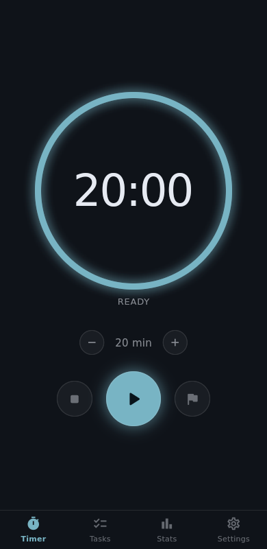
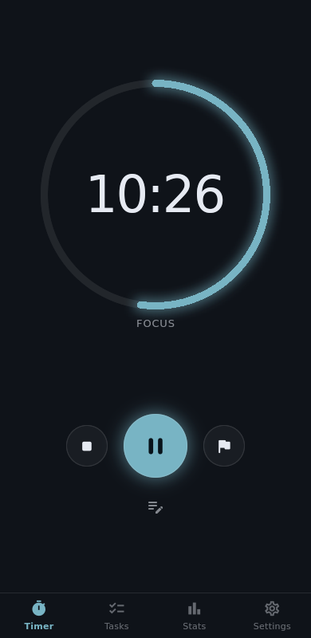
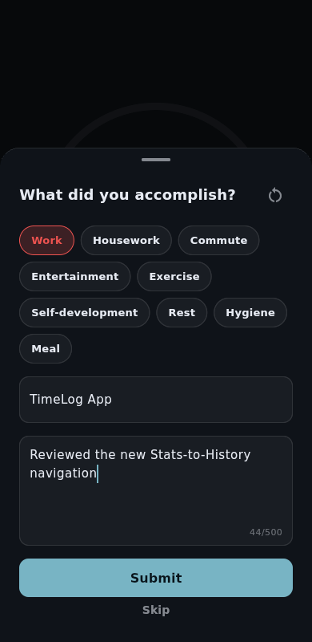
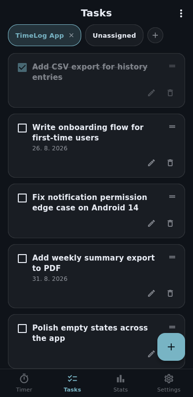
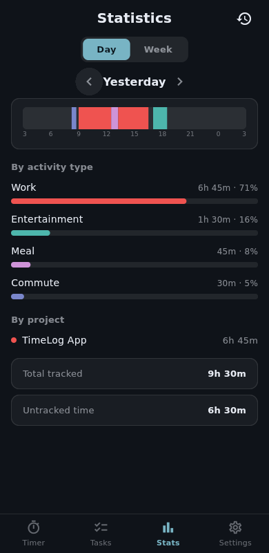
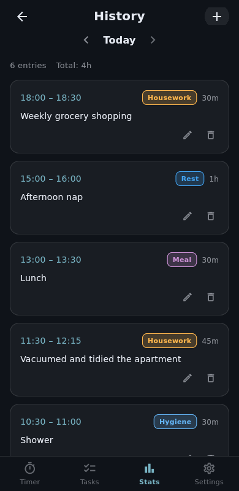

# TimeLog

A countdown timer app with time tracking capabilities, built with Flutter.

## Description

TimeLog helps you run focused countdown sessions and automatically keeps a log of how you
spent that time. When a session ends (or is stopped early), you tag it with a description
and an activity type, and it's saved to a local history you can browse by day.

Key features:

- Countdown timer with adjustable duration (5–60 minutes, 5-minute steps)
- Automatic time-entry logging on timer completion or manual stop
- Twelve built-in activity types — Work, Housework, Meeting, Communication, Travel,
  Entertainment, Exercise, Self-development, Rest, Hygiene, Meal and Other — each with its own
  colour. Most have subtypes (for example paid / unpaid work, walk / running / gym, breakfast /
  lunch / dinner / snack) shown as shades of the type's colour
- Optional project name for Work and Housework, and a free-text name for Other, with
  autocomplete suggestions that are kept separate for paid work, unpaid work, housework and
  other activities
- Tasks tab: a simple to-do list with projects. Each project has one of the four categories above, shown as a coloured dot, and can be changed or deleted from a menu on long press
- History screen with day navigation, daily summary, per-entry edit/delete, and manually
  adding a past entry
- Statistics screen with daily/weekly toggle, a visual timeline of the day/week's entries,
  time breakdown by activity type (with subtypes), by project and by name for Other entries,
  and an untracked-time summary
- Settings screen with a daily reminder notification (toggle + time picker) that nudges you
  to start a timer, and can auto-start one when tapped
- Fully offline — entries are persisted locally in SQLite (no server, no account)
- Alarm sound + native notification when the timer finishes, even while backgrounded
- iOS Live Activity / Dynamic Island support with pause/resume/stop actions from the lock screen
- Three color themes (Ember, Midnight, Paper) — Midnight is the default
- Cross-platform Flutter app: Android, iOS, Linux, macOS, Windows, Web

## Screenshots

<p>
  
  
  
</p>
<p>
  
  
  
</p>

## Prerequisites

- Flutter SDK with Dart `^3.10.4` (the repo pins Flutter `3.44.6` via `.fvmrc` if you use
  [FVM](https://fvm.app/))
- For Linux desktop:
  - Build: `clang`, `cmake`, `ninja-build`, `pkg-config`, `libgtk-3-dev`,
    `libgstreamer1.0-dev`, `libgstreamer-plugins-base1.0-dev`
  - Runtime (audio playback): `gstreamer1.0-plugins-base` and `gstreamer1.0-plugins-good`
    must also be installed — the `-dev` packages above only provide headers, not the
    GStreamer plugin binaries (e.g. `playbin`) that `audioplayers` needs at runtime. Without
    them, the app crashes on startup when it tries to play the alarm sound.
- For iOS: Xcode with iOS 16.2+ deployment target (required for the Live Activity feature)

## Setup

Clone the repo, then install Flutter dependencies:

```sh
flutter pub get
```

No `.env` file or environment variables are required — the app has no server-side
configuration.

### Code generation

This project uses `build_runner` for code generation (Drift, Freezed, Riverpod). Generated
files are committed to the repo, so a fresh checkout works without running it. Re-run it
after changing any file annotated with `@DriftDatabase`, `@freezed`, or `@riverpod`:

```sh
dart run build_runner build --delete-conflicting-outputs
```

## Usage / Running

```sh
flutter run -d linux    # or macos, windows, chrome, <device-id> for Android/iOS
```

### Building

```sh
flutter build linux
```

The output binary is at `build/linux/x64/release/bundle/timelog_app`. See [DOCS.md](DOCS.md#deployment)
for build commands for other platforms.

## Documentation

See [DOCS.md](DOCS.md) for project structure, architecture (platform channels, database),
deployment, testing, and troubleshooting.

See [ROADMAP.md](ROADMAP.md) for planned changes (new activity types) and what already exists.

## Author

**Martin Jablečník**

- Website: [www.jablecnik.com](https://www.jablecnik.com)
- GitHub: [@mjablecnik](https://github.com/mjablecnik)

## Show your support

Give a ⭐️ if this project helped you!

## License

Copyright © 2026 Martin Jablečník. This project is licensed under the MIT License.
